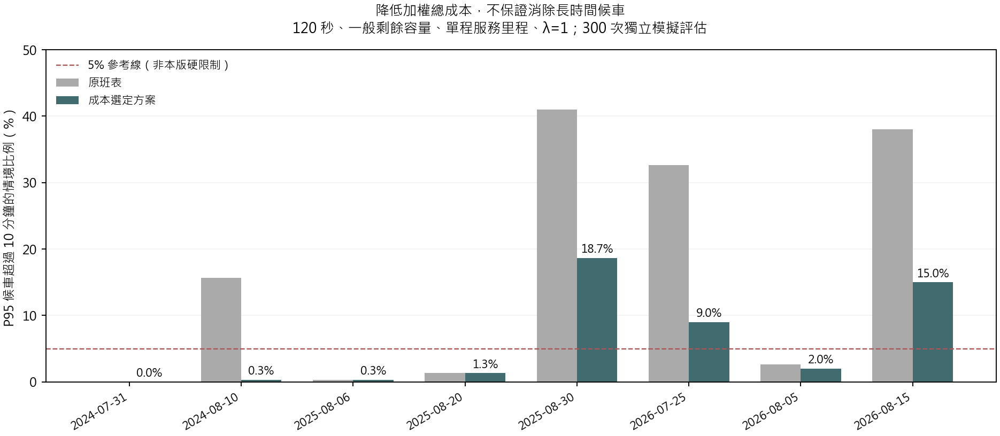

# 大稻埕煙火人流分析與捷運班次模擬

**[公開網站：稻埕觀測室](https://shu-ming0808.github.io/Statistical-Practice-final/)** · [詳細預測資訊](https://shu-ming0808.github.io/Statistical-Practice-final/#/research) · [18–23 時增減班比較](https://shu-ming0808.github.io/Statistical-Practice-final/#/research?tab=dispatch)

目前人流預測先告一段落，**保留四站訓練、北門散場加權 XGBoost**，接續做候車情境與列車調度。Ridge、GAM 保留作比較及解釋，未加權 XGBoost 作加權效果對照；融合未採用。逐版實驗入口與重複圖表已移除，歷程仍可由 Git 查閱。

## 資料與分析流程

- **單位：**活動 × 車站 × 來源時段；21 場、北門／大橋頭／雙連／民權西路、18–23 時，共 504 列。504 列不是 504 個獨立活動。
- **目標：**北門各來源時段進站人次，主要評分為 2024–2026 同九場、54 列。
- **保留輸入：**車站、時段、車站×時段、週末、年內日期、年度趨勢、過去 56 日同星期一般日基準、事前預定展演結束後兩小時的車站重疊訊號。
- **未放入最終模型：**當日先前人流、實測天氣、事後網路聲量、年度經費、未核實的熱度與活動規模。
- **時間界線：**依活動前一天規劃輸入，但歷史 OD／日曆的實際發布時點尚未完全核實；目前是回顧比較，不能稱已驗證嚴格 D−1 可部署。九場已反覆用於開發，仍需新活動驗證。

~~~mermaid
flowchart TD
    A["活動 × 車站 × 時段 來源、缺值與事前可得性檢查"] --> B["只用過去年份訓練 訓練內補值、標準化與編碼"]
    B --> C["Ridge：線性與收縮"]
    B --> D["GAM：平滑非線性"]
    B --> E["XGBoost：門檻與交互作用"]
    C --> F["同九場北門比較 MAE、RMSE、尖峰"]
    D --> F
    E --> F
    F --> G["保留四站散場加權 XGBoost"]
    G --> H["分鐘到達情境 → 分方向候車 → 班次方案"]
~~~

## 如何調參，最後保留什麼？

1. **依年份向前驗證，不隨機打散。**預測 2024／2025／2026 時，分別只用過去 12／15／18 場訓練；更早年份的留出預測用來選參數。
2. **搜尋各模型的候選設定。**Ridge 比較 25 個 λ；GAM 比較 60 組平滑／收縮／基底；XGBoost 比較 180 組預先定義的組合，另試學習率×樹數與 early stopping。不是所有列出的數值做完整笛卡兒積。
3. **基礎設定曾用散場低估罰 2 倍選擇。**之後加入一般日基準時保留原設定；又用過去北門六時段 MAE 比較局部樹設定、早停及訓練加權。
4. **最後保留原樹設定＋散場訓練加權。**early stopping 不是目前模型的一部分。4 倍權重是提高特定訓練列的重要性，和「低估罰 2 倍」不同。保留 4 倍的決定參考了這九場比較，不能包裝成完全未見資料上的選模。
5. **目前固定模型，不再進行新搜尋。**下方年度設定與完整候選紀錄已保存，[重跑入口](src/run_forecast.py)只重現凍結結果。

| 模型 | 調整內容 | 在本專案的直觀角色 |
|---|---|---|
| Ridge | λ 共 25 值，約 10⁻⁴–10²；程式 alpha=nλ | 線性關係與車站×時段效果，收縮不穩定係數 |
| GAM | 平滑 λ：0.1／1／10／100／1000；係數懲罰：0.001／0.01／0.1／1；基底：4／5／7 | 允許有資料支持的連續變數彎曲，同時限制失穩 |
| XGBoost | 樹深、樹數、學習率、葉節點門檻、L1/L2、列／欄抽樣；另比較早停 | 學條件門檻與組合；是否較準以驗證結果決定 |

### 最後保留的年度設定

| 評估年度 | Ridge λ | GAM：平滑λ／係數懲罰／基底數 | XGBoost：樹深／樹數／學習率 |
|---|---:|---|---|
| 2024 | 0.000177828 | 0.1／0.001／5 | 3／250／0.10 |
| 2025 | 0.177827941 | 0.1／0.001／5 | 4／250／0.05 |
| 2026 | 0.177827941 | 0.1／0.001／7 | 4／250／0.05 |

XGBoost 其餘為 min_child_weight=1、reg_lambda=1、reg_alpha=0、subsample=1、colsample_bytree=1、平方誤差目標、hist。北門事前散場重疊比例為 o 時，原始權重 **1+3o**，其他列為 1，再令每場平均權重為 1。未知結束時間不加權。

[完整候選格點與調參紀錄](result/forecast/tuning_record.json)／[凍結設定](configs/forecast.json)／[擬合與 GAM 支持檢查](result/forecast/fits.json)

## 最終結果與解讀

同九場北門 54 個來源時段，單位為人次／來源時段，越低越好。

| 模型 | MAE | RMSE | 實際尖峰時段平均絕對誤差 |
|---|---:|---:|---:|
| Ridge | 845.44 | 1,547.49 | 2,681.26 |
| GAM | 830.71 | 1,315.75 | 2,305.11 |
| XGBoost 未加權 | 473.91 | 766.90 | 749.02 |
| **XGBoost 散場加權（保留）** | **440.28** | **690.91** | **747.14** |

加權相對未加權的 MAE 改善約 **7.1%**，尖峰誤差只略降。2024/8/10 最高峰實際 11,101、預測約 8,359，仍少估 **2,742 人次（24.7%）**。不能以整體平均誤差替代尖峰風險評估。

### 各場平均與誤差直方圖

每組是同場六時段平均；這是分組長條圖，平均接近不代表每個時段都準。

直方圖負值＝低估，正值＝高估，每格 500 人次；右圖越接近虛線越準。[九場逐時圖](result/forecast/figures/hourly_profiles.png)可看尖峰時點與低估。

### 輸入變數相關熱力圖

只用 **2026 前北門的 18 場訓練資料**、七項代表性輸入，以兩兩非缺值 Spearman 計算。這是變數相關，不是樹深／學習率等超參數的相關；同場六時段不獨立，不能直接作因果或顯著性解讀，也不據此自動刪變數。

## Ridge 最終公式與其他模型細節

Ridge 使用訓練期標準化後的向量 z（含車站、時段、交互作用及缺值旗標）：

$$
(\hat\beta_0,\hat\beta)=\arg\min_{\beta_0,\beta}
\left[\frac1n\sum_{i=1}^{n}(y_i-\beta_0-z_i^\top\beta)^2+\lambda\|\beta\|_2^2\right],
\qquad \hat y=\max(0,\hat\beta_0+z^\top\hat\beta).
$$

截距不懲罰；2026 評估折 n=432、λ=0.177827941，故 sklearn alpha=76.8216705。這一折截距為 **1589.8432**；部分係數如下，其餘不可省略，完整可計算公式見連結。

| 項目 | 係數 | 解讀尺度 |
|---|---:|---|
| 週末 | +278.50 | 0→1，其他設計欄位固定 |
| 一般日基準 | +532.87 | 增加一個訓練標準差（約 709.71 人次） |
| 北門散場第一小時重疊 | +452.73 | 標準化重疊欄增加 1 |
| 北門散場第二小時重疊 | +623.29 | 標準化重疊欄增加 1 |

這些是受懲罰的條件預測係數，不是活動造成的人數增量。參考車站為北門、時段為 18。[完整係數表](result/forecast/tables/ridge_coefficients_2026.csv)／[公式、補值及標準化常數](result/forecast/ridge_equation_2026.json)。

- **GAM：**Gaussian identity，加法結構；連續欄至少六場已知資料，指定可平滑欄另需至少八個不同值。平滑使用 cubic P-spline，搭配二階係數差分與全係數 L2；其餘為受懲罰線性項。一般日基準在此設定是線性項，不能宣稱所有連續變數都用曲線。[中心化曲線資料](result/forecast/tables/gam_components_2026.csv)。
- **XGBoost：**逐棵樹修正前面模型的誤差，可呈現門檻與交互作用；本案採樣本權重的平方誤差訓練。輸出低於 0 時截為 0。[特徵分裂增益](result/forecast/tables/tree_importance_2026.csv)不代表因果影響。
- **融合：**等權及過去留出預測學權重都曾比較，未採用。融合不是一定比單模型準；最終入口不再跑已淘汰的融合／選站／lag 實驗。

[完整結果](result/forecast/report.md)／[年度指標](result/forecast/tables/annual_metrics.csv)／[實作與完整公式](process.md)／[重現檢核](result/forecast/validation.json)

<!-- duckdb-benchmark:start -->
## 為何使用 DuckDB：人流資料實測

2026-10-20 使用兩邊共有的 **2026 年 7 月、8,366,652 列 OD** 比較。
MySQL 先轉為日期／數值型別，並建立支援篩選及分組的三個索引；DuckDB 直接讀清理後 Parquet。
全部輸入逐列排序後的 SHA-256 相同，各次查詢輸出也一致。

以下為暖機 2 次後、重複 7 次的**耗時中位數，單位 ms，越小越快**：

| 相同工作 | MySQL／含分組索引 | DuckDB／4 執行緒 | 本機比較 |
|---|---:|---:|---|
| 北門單日 18–23 時逐時人次 | 0.727 | 2.949 | MySQL 約 4.1 倍 |
| 四站全月晚間逐日逐時人次 | 103.220 | 17.136 | DuckDB 約 6.0 倍 |
| 全站全月依車站與時段彙總 | 3092.604 | 39.110 | DuckDB 約 79.1 倍 |
| 全月非零 OD 彙總前 20 名 | 3529.671 | 43.037 | DuckDB 約 82.0 倍 |

因此本案用 **DuckDB 處理大量人流彙總，MySQL 管理活動、天氣、經費等關聯資料**。
小範圍索引查詢由 MySQL 勝出，不能宣稱 DuckDB 所有工作都比較快。
MySQL 沿用 128 MiB buffer pool，DuckDB 專案設定為 4 執行緒／2 GB；兩者的記憶體口徑與儲存格式不同，
上述倍數只代表本機方案。另有 DuckDB 單執行緒／128 MiB 對照，以及 MySQL 補索引前後比較。

[完整實測 README、技術理由與重現方法](result/duckdb_benchmark/README.md)／
[逐次耗時](result/duckdb_benchmark/timings.csv)／[量測程式](scripts/benchmark_duckdb_mysql.py)
<!-- duckdb-benchmark:end -->

## 候車與網站

北門為高運量六節編組。保留 1,134 組「均勻／寬峰／集中峰 × 剩餘容量等」候車情境與四站官方班表。最大容量 2,220 人不等於本站可上車人數；進站前背景載量仍是假設，離站才加入上車人數。同方向有滯留時必已用滿可用容量。

首頁提供列車圖示及綠→黃→紅載客率；北門雙向候車按可調門檻變色，另外三站灰色待建模。現行一般班表搭配歷史需求是情境比較，不是當年實測候車或已完成全線班表最佳化。

[候車情境結果](result/queue_dispatch_v1/report.md)／[分鐘到達圖](result/queue_dispatch_v1/figures/arrival_queue_comparison.png)／[營運資料與缺口](docs/metro_operations.md)／[網站與發布](app/README.md)

歷史版本：只增班、固定原班表（不代表目前增減班方案）

### 組員新增：候車分布、MC 與增班搜尋

- **候車分布：**用先到先上的累積曲線算平均、P95 與跨班滯留；沿用原 XGBoost，沒有重訓。
- **MC 情境：**九場各 1,000 次，共 9,000 次。人潮形狀、方向比例、剩餘容量與到達隨機性共同變動；平均候車的情境中位數為 2.90 分，P95 的情境中位數為 6.15 分。這是研究假設下的分布，不是實測候車。
- **增班搜尋：**200 次情境找插車位置，另 300 次評估；比較 0–4／0–8 班及一般剩餘容量／90% 空間。原班次保留。以 2024/8/10、120 秒、90% 空間為例，找到的 5 班方案將「P95 > 10 分」情境比例由 26.3% 降至 4.3%；不是已證明最少班數，也不是最小成本解。

原 MC 只排除本場，仍會借用較晚活動的誤差；只能作回顧壓力測試。新成本比較改用較早活動，但兩份報告的樣本與情境分布不同，不能直接相減當成成本項效果。新增分析目前尚未接入網站。

[候車不確定性](result/queue_uncertainty_v1/report.md)／[增班 0–4 班](result/dispatch_optimization_v1/report.md)／[0–8 班：一般容量](result/dispatch_sensitivity_same_capacity_8/report.md)／[0–8 班：90% 空間](result/dispatch_sensitivity_empty_extra_8/report.md)

### 增班成本＋候車加權比較

依活動星期選官方一般平日／週六班表，保留原班次與時刻。在每個班數的啟發式方案中，以 **200 次訓練情境**選擇加權總成本最低的 0–8 班方案，再用另外 **300 次情境**評估；不根據評估結果重選班數。

$$
\min_{x\in\mathcal P} J(x)
=\underbrace{un(x)L}_{\text{增加的營運成本}}
+\underbrace{\lambda v\frac1S\sum_{s=1}^{S}\left[W_s(x)+60R_s(x)\right]}_{\text{平均候車與滯留估值}}.
$$

| 符號 | 定義與單位 |
|---|---|
| $\mathcal P,\ n(x)$ | 搜尋出的候選班表；$n(x)$ 是新增班數，不是所有可能班表的窮舉 |
| $L$ | 松山—新店相鄰站加總 18.77 km；比較僅計服務 18.77 km、另假設全程回送共 37.54 km。實際出入庫／回送仍未知 |
| $u$ | 每列車公里增量成本；先以使用者提供的 128.05 元／公里試算，單位與年度仍待核對 |
| $W_s(x)$ | 情境 $s$ 下雙向排隊積分，單位人分鐘；所有方案計至 18:00 後 420 分鐘 |
| $R_s(x)$ | 期末未上車人數；每人加 60 分鐘是懲罰假設，不是觀測值 |
| $v$ | 每人每分鐘候車時間的貨幣估值，單位為元／人分鐘 |
| $\lambda$ | 候車成本權重 0.5／1／2；由研究偏好設定，不是用測試結果學出的權重 |

**時間價值第一版以最低時薪換算。**依[勞動部資料](https://www.mol.gov.tw/1607/28690/2282/2284/2290/7121/)，2026/1/1 起最低時薪為 196 元，因此設定：

$$
v_0=\frac{196}{60}\approx3.27\quad\text{元／人分鐘}.
$$

這是本研究的估值假設，並非實測候車時間價值，也不是北捷支付給乘客的費用。例如 100 人各少等 5 分鐘，時間效益估值為 $100\times5\times196/60\approx1,633.33$ 元；不能稱為營運現金節省。計算保留 $196/60$，只在顯示時四捨五入。

以 $\lambda=0.5,1,2$ 比較，相當於 1.63／3.27／6.53 元／人分鐘。僅計單程服務每班約 2,403.50 元；另假設一次全程空車回送約 4,807.00 元。回送未計作載客服務，也未模擬其效益。完整新增里程、單位成本口徑與幣值基年仍待核實。

**官方距離已匯入 MySQL。**採[捷運最短站間距離](https://data.taipei/dataset/detail?id=4acb4911-0360-4063-808d-fcee629508b3)，沿官方路線逐段加總；不能拿可能跨線的端點最短距離代替。新增 14,161 筆去重後 OD 距離、29 筆綠線路段關聯與來源版本。[距離、成本與資料庫說明](result/metro_distances/report.md)

新增列車檢查同方向前後原班與新增班的 120／180 秒間隔，含分析起點前的原班。成本版只借用較早活動的誤差，2024/7/17 因沒有可用歷史誤差跳過，其餘八場只有 1–8 場誤差來源；增加 MC 次數不會增加活動樣本。

<!-- dispatch-cost-results:start -->

**完整比較結果。**8 場 × 2 種班距 × 2 種容量 × 2 種里程成本 × 3 種候車權重，共 192 組選擇；每組比較 0–8 班，共 1,728 筆成本比較。最早一場缺過去誤差而跳過。

**下表條件：**120 秒、加班車剩餘容量同一般列車、僅計單程服務 18.77 km、$\lambda=1$。

| 活動 | 增班 | 總等待降低 | 平均候車中位數：原→新（分） | P95 > 10 分情境：原→新 | 加權總成本差（元） |
|---|---:|---:|---|---|---:|
| 2024-07-31 | 0 | 0.0% | 2.72 → 2.72 | 0.0% → 0.0% | +0 |
| 2024-08-10 | 8 | 19.2% | 3.62 → 3.23 | 15.7% → 0.3% | -19,227 |
| 2025-08-06 | 0 | 0.0% | 2.70 → 2.70 | 0.3% → 0.3% | +0 |
| 2025-08-20 | 0 | 0.0% | 2.70 → 2.70 | 1.3% → 1.3% | +0 |
| 2025-08-30 | 8 | 33.3% | 3.91 → 3.27 | 41.0% → 18.7% | -149,322 |
| 2026-07-25 | 8 | 30.5% | 3.63 → 3.20 | 32.7% → 9.0% | -81,450 |
| 2026-08-05 | 1 | 1.4% | 2.76 → 2.73 | 2.7% → 2.0% | +253 |
| 2026-08-15 | 8 | 32.2% | 3.66 → 3.21 | 38.0% → 15.0% | -107,900 |

八場合計增 33 班，試算營運支出約 79,315 元；評估總等待量降低 22.2%。含候車估值的加權總成本差為 -357,646 元，**不是現金節省**。這是八場情境期望值相加，不是八場實測績效。

- 3 場選不增班。2026-08-05 增 1 班，評估總成本反增約 253 元；訓練選得好，不保證另一批情境仍較好。
- 4 場選到 8 班的搜尋上限，不能當成不限班數的最優解。2025-08-30、2026-07-25、2026-08-15 的長候車情境仍超過 5% 參考線；最小成本不等於滿足候車服務門檻。
- 2024/8/10 若另計假設全程空車回送，選 2 班；費用與候車權重會改變選擇。全組合保留在下方 CSV，未用評估表挑一組最好看的參數。

總等待降低＝各情境總候車人分鐘的平均值比較；平均候車中位數則是各情境「每人平均等待」的中位數，兩者不同。P95 超標比例的分母是 300 次模擬情境，未疏運完也列為超標；不是有多少百分比乘客等超過 10 分鐘。

[完整逐場指標](result/dispatch_cost/reference_summary.csv)／[選定北門離站時刻](result/dispatch_cost/reference_timetable.csv)／[全部條件彙總](result/dispatch_cost/scenario_summary.csv)

**實作範圍：**成本、候車權重、120／180 秒間隔及獨立亂數評估已執行；起站就緒、備車、全線衝突與即時滾動調度尚未納入。同一種子重跑是可重現性檢查，沒有增加獨立活動樣本。

<!-- dispatch-cost-results:end -->

[成本比較結果與選定時刻](result/dispatch_cost/report.md)／[權重敏感度圖](result/dispatch_cost/figures/weight_sensitivity.png)／[可調參數](configs/dispatch_cost.json)

**適用範圍：**固定班數且每班成本相同時，成本不改變時刻搜尋，只影響最後選幾班。此版不是全面重排班表或已證明的全域最佳；尚未加入起站就緒／調度提前量、司機、備車、折返及全線衝突，P95 10 分鐘也不是硬限制。實際資料發布時間未全面核實，現行班表配歷史需求仍是回顧情境，不是已驗證的 D−1 營運部署。理論完整限制見[增班最佳化公式](docs/metro_operations.md#8-假日基準班表與增班最佳化公式)。

<!-- green-dispatch:start -->
## 18:00–23:00 增減班與移時（目前版本）

只調整松山新店線。以原四站預測與過去一般日 OD 推估沿線載客及轉乘，紅／橘線班表不變。沒有無來源的候車合格門檻。平均涵蓋沿線背景旅次，不是北門散場尖峰平均，不能與舊版單站平均直接比較。

$$\min_{x\in\mathcal P}\Delta C_{\rm op}(x)+\lambda(196/60)\,S^{-1}\sum_s W_s(x).$$

原班表也是候選；200 次訓練選擇、300 次獨立模擬評估，並非新活動實測驗證。下表 λ=1，成本包含新增服務的假設空車回送，減班只扣可避免的單程服務成本。

| 活動 | 原班數→新班數 | 增／減／移時 | 可變成本差（元） | 平均候車原→新（分） | 總等待變化 |
|---|---:|---:|---:|---|---:|
| 2024-07-31 | 125→172 | +47／−0／82 | +225,929 | 3.38→2.67 | -21.2% |
| 2024-08-10 | 88→172 | +84／−0／59 | +403,788 | 4.67→3.19 | -31.6% |
| 2025-08-06 | 125→180 | +55／−0／85 | +264,385 | 3.37→2.62 | -22.3% |
| 2025-08-20 | 125→179 | +54／−0／87 | +259,578 | 3.38→2.63 | -22.2% |
| 2025-08-30 | 88→178 | +90／−0／59 | +432,630 | 4.67→3.08 | -34.0% |
| 2026-07-25 | 88→145 | +57／−0／71 | +273,999 | 4.64→3.35 | -27.8% |
| 2026-08-05 | 125→179 | +54／−0／86 | +259,578 | 3.36→2.62 | -22.2% |
| 2026-08-15 | 88→147 | +59／−0／66 | +283,613 | 4.64→3.32 | -28.4% |

合計增 500 班、減 0 班、移時 595 班；可變營運成本差 +2,403,498 元，總候車人分鐘變化 -26.2%。負的成本差才是本模型下的可變支出節省；不是實測節省。

**解讀界線：**這是過去活動配現行班表的情境比較；其他路線的車上容量、備車、司機與折返未完整納入。OD 最短路徑與步行時間是假設，不能稱為實際轉乘軌跡。

[完整方法與權重比較](result/green_dispatch/report.md)／[逐班增減及起站時刻](result/green_dispatch/timetable.csv)／[四站數據](result/green_dispatch/station_impacts.csv)

<!-- green-dispatch:end -->

## 快速開始

~~~powershell
uv sync --inexact --group analysis
uv run --group analysis python -X utf8 src/run_forecast.py
uv run --group analysis python -X utf8 -m unittest discover -s tests -p "test_forecast*.py"
~~~

隊員需私下取得 .local/forecast/analysis_input.csv 與 reference_predictions.csv；以雜湊確認凍結資料。**不必先跑十九個版本，也不用連 MySQL。**逐列資料與模型保持私有；只看 README／PNG 不用安裝環境。命令重現既定模型，不會以新資料自動調參或覆蓋網站快照。

候車／增班另需 `.local/forecast/predictions.csv` 與 `.local/transit_reference/20261015/` 官方原始快照：

~~~powershell
uv sync --inexact --extra transit --group analysis
uv run --extra transit --group analysis python -X utf8 src/run_queue_uncertainty.py
uv run --extra transit --group analysis python -X utf8 src/run_dispatch_optimization.py
uv run --extra transit --group analysis python -X utf8 src/run_dispatch_cost.py --fresh --update-readme
~~~

`--fresh` 重新搜尋全部增班方案，`--update-readme` 將逐場結果同步到本頁；未加 `--fresh` 可使用同版本快取續跑。只重繪圖表可用 `--report-only --update-readme`，但必須與原計算設定相同。

更新官方距離及資料庫：`uv run --extra transit --group analysis python -X utf8 src/import_metro_distances.py --import-db`。已有快照會重用；不加 `--import-db` 則只解析、匯出。

原始資料前處理、資料庫與文字雲

~~~powershell
.\.venv\Scripts\python.exe -X utf8 src/main.py --reuse-clean --mysql
.\.venv\Scripts\python.exe -X utf8 src/import_weather.py
.\.venv\Scripts\python.exe -X utf8 src/threads_web_collect.py
.\.venv\Scripts\python.exe -X utf8 src/ptt_web_collect.py
~~~

這些流程保留；公開網站使用快照，不需 Tailscale。SQL、原始資料及帳密不推送。Threads／PTT 文字雲是公開搜尋樣本，不代表全站聲量。

## 專案結構

~~~text
統計實務/
├── README.md                  # 最終方法、結果與參考資料
├── process.md                 # 實作、公式、候車及發布細節
├── configs/forecast.json      # 凍結資料資格與年度參數
├── src/
│   ├── run_forecast.py        # 單一人流重現入口
│   ├── forecasting/           # 編碼、Ridge、GAM、XGBoost、指標及圖表
│   ├── queueing.py            # 列車批次服務
│   ├── run_queue_scenarios.py # 分鐘到達與候車情境
│   ├── run_queue_uncertainty.py # MC 候車分布（組員回顧版本）
│   ├── run_dispatch_optimization.py # 固定增班數搜尋（組員版本）
│   ├── run_dispatch_cost.py  # 較早場次誤差、成本選班與獨立評估
│   ├── report_dispatch_cost.py # 逐場比較、班次明細與 README 同步
│   ├── run_green_dispatch.py # 18–23 時綠線增減班、移時及轉乘評估
│   ├── green_dispatch.py     # 沿線載客守恆與候選班表搜尋
│   ├── prepare_green_dispatch.py # 過去 OD、四站預測與轉乘路徑
│   ├── report_green_dispatch.py # 成本等待圖表、報告及公開成果
│   ├── import_metro_distances.py # 官方距離入庫與沿路線加總
│   └── main.py                # 原始捷運資料前處理
├── result/
│   ├── forecast/              # 最終報告、參數、係數、表格及 PNG
│   ├── queue_dispatch_v1/     # 候車與官方營運資料
│   ├── queue_uncertainty_v1/ # MC 候車區間與因子比較
│   ├── dispatch_optimization_v1/ # 固定增班數方案
│   ├── dispatch_cost/        # 加權成本、選定班表與敏感度
│   ├── green_dispatch/       # 目前增減班方案、原四站影響與圖表
│   └── metro_distances/      # 官方距離來源、沿線里程與匯入稽核
├── app/                       # 前端、FastAPI、公開快照
├── data/                      # 本機原始／整理資料，不公開
├── .local/forecast/           # 私有輸入、逐列預測與模型
├── tests/                     # 模型、資料、候車與網站測試
├── docs/                      # 來源、規格與研究資料
└── results/                   # 文字雲及其他研究成果
~~~

## 詳細說明與參考資料

- [資料前處理](docs/data_preprocessing.md)／[資料庫結構](docs/database_schema.dbml)
- [Threads](docs/threads_collection.md)／[PTT](docs/ptt_collection.md)／[Google Trends](mysql/GOOGLE_TRENDS_README.md)
- [事前天氣證據](docs/d1_weather_audit.md)／[研究文獻](docs/references.md)
- [融合權重與列車調度：完整公式及最佳解存在性證明](docs/融合權重與列車調度_最佳解存在性證明.md)：總和自由、總和為 2／3、候車與成本的完整模型；數學設計，不是新一輪實驗結果。
- [中文理論與證明 PDF](output/pdf/大稻埕人流預測與列車調度_理論與證明.pdf)：模型、融合與候車調度的假設、定理、證明及文獻；[LaTeX 原始碼](docs/theory_paper/main.tex)。

| 文獻 | 本專案用途與界線 |
|---|---|
| [Hoerl & Kennard（1970）](https://doi.org/10.1080/00401706.1970.10488634)／[Ridge 實作](https://scikit-learn.org/stable/modules/generated/sklearn.linear_model.Ridge.html) | L2 收縮；本案採平均平方損失，所以 alpha=nλ |
| [Hastie & Tibshirani（1986）](https://doi.org/10.1214/ss/1177013604) | 加法平滑；不保證比線性或樹模型準 |
| [Eilers & Marx（1996）](https://doi.org/10.1214/ss/1038425655) | P-spline 與係數差分懲罰；基底、支持門檻為本案設定 |
| [Chen & Guestrin（2016）](https://arxiv.org/abs/1603.02754) | 正則化加法樹；格點、散場權重與選模規則為自行設定 |
| [Breiman（1996）](https://statistics.berkeley.edu/sites/default/files/tech-reports/367.pdf) | 用留出預測學融合；未主張融合必勝 |
| [Cawley & Talbot（2010）](https://jmlr.org/papers/v11/cawley10a.html) | 選模與評估偏差；保留九場反覆使用的限制 |
| [Hyndman & Athanasopoulos，§5.10](https://otexts.com/fpp3/tscv.html) | 用過去預測未來的向前驗證 |
| [Santanam 等（2021）](https://arxiv.org/abs/2106.05359) | 需求預測銜接列車調度；未聲稱已重現最佳化 |

資料來源：

- [北捷分時進出站運量](https://data.taipei/dataset/detail?id=63f31c7e-7fc3-418b-bd82-b95158755b4d)
- [固定／變動成本](https://www.metro.taipei/cp.aspx?n=20CB8DE3F41B4111)：參考 114 年審定決算書。
- [變動／固定公里數](https://whhr.gov.taipei/News_Content.aspx?n=0121E4C78246FC0D&s=3E147DD6A74BE990)
- [天氣實測](https://codis.cwa.gov.tw/StationData)：氣象署 CODiS，只作事後探索。
- [GFS 歷史操作型預報](https://gdex.ucar.edu/datasets/d084001/)／[NOAA AWS 公開時間證據](https://registry.opendata.aws/noaa-gfs-bdp-pds/)：曾評估的事前天氣來源；最終模型未採用天氣欄位。
- [特殊節假日](https://data.gov.tw/dataset/14718)：政府行政機關辦公日曆表。
- [大稻埕煙火排程參考](https://data.gov.tw/dataset/7778)：觀光資訊活動資料庫。

候車與列車調度官方來源（2026-10-15 至 2026-10-26 分批核對）：

- 四站時刻表：[北門](https://web.metro.taipei/pages2026/WebStation/105/7)／[大橋頭](https://web.metro.taipei/pages2026/WebStation/128/7)／[雙連](https://web.metro.taipei/pages2026/WebStation/054/7)／[民權西路](https://web.metro.taipei/pages2026/WebStation/055/7)。八份自 2026/8/30 生效，橘線往南勢角兩份自 10/1 生效；都是一般離站表。每份 PDF 的直連與 SHA-256 見 [來源清單](result/queue_dispatch_v1/metro_source_snapshot.csv)。
- 北門假日基準：[往松山 PDF](https://web.metro.taipei/img/ALL/timetables/105a.PDF)／[往新店方向 PDF](https://web.metro.taipei/img/ALL/timetables/105b.PDF)，各含週六、週日及國定假日欄位。已另匯出 [假日逐班 CSV](result/queue_dispatch_v1/beimen_holiday_baseline.csv)（668 列，次日以 24:xx 表示）；[保留原班表、只選增班的公式](docs/metro_operations.md#8-假日基準班表與增班最佳化公式)與比較方式已整理；另有成本候選方案比較，尚未求得全線可行最佳班表。
- [相鄰兩站行駛與停靠時間](https://data.taipei/dataset/detail?id=513e97fe-6a98-4a0d-b7dc-11122c8638d4)／[官方 CSV](https://data.taipei/api/frontstage/tpeod/dataset/resource.download?rid=c32998fa-c9b2-4324-9016-e19fbe0815f1)：推算同線候選發車站→四站的行車部分，不含未知整備／出庫／插車時間。
- [高運量六節編組最大載客量](https://www.dorts.gov.taipei/News_Content.aspx?n=2A66A485FACB0D5B&s=F32662CFF6FE4D80)：370 人／節、2,220 人／列；不是剩餘容量。
- [北捷 API 申請與資料目錄](https://www.metro.taipei/cp.aspx?n=BDEB860F2BE3E249)／[API 規格第 1 頁項次 6](https://www-ws.gov.taipei/001/Upload/405/relfile/18288/116939/26d47117-1927-48fb-9293-3f7879ec8092.pdf)：車次、方向及四級擁擠度，30 秒更新；尚未申請接入，不能直接當精確人數。
- [北捷載重與票證人流模型](https://www.metro.taipei/News_Content.aspx?n=30CCEFD2A45592BF&s=3C06D5F73D9377D0&sms=72544237BBE4C5F6)：車上背景載客估計的官方實務依據。
- [新莊機廠與迴龍進出軌](https://www.dorts.gov.taipei/cp.aspx?n=A7D84926581F5817&s=2091F0361804122D)／[新店機廠與小碧潭支線限制](https://www.dorts.gov.taipei/News_Content.aspx?n=2A66A485FACB0D5B&s=89085E307909460C&sms=87415A8B9CE81B16)：機廠位置與路徑線索，沒有公布活動當日可用備車與就緒時間。
- [松山新店線班距](https://www.metro.taipei/cp.aspx?n=EAD981369A065968&s=0F3F913C344BA050)：2026-10-18 核對，北門所在重疊區間平日尖峰平均約 3 分鐘；可作研究班距參考，並非號誌最小安全班距。
- [大稻埕活動疏運公告](https://www.gov.taipei/News_Content.aspx?n=F0DDAF49B89E9413&s=DA77537CE5B880D7&sms=72544237BBE4C5F6)：公告依人潮彈性加開，未提供活動當日可用備車數。第一版省略備車數限制、以起站至北門行車時間作調度提前量的設計，見 [調度研究範圍](docs/metro_operations.md#7-第一版調度研究範圍2026-10-18)；目前已有綠線增減班／移時及原四站轉乘試算，仍未完成備車、折返與全線可行性驗證。
- [114 年審定決算書 PDF 第 51 頁](https://www-ws.gov.taipei/001/Upload/405/relfile/18288/7602/4627504c-4034-4a4e-b403-c692be626487.pdf#page=51)：合併勞務成本明細表的年度固定／變動運輸費用；不是單班增量成本，參見 [成本口徑](docs/metro_operations.md#4-營運成本有找到仍不能直接當每加一班的成本)。
- [勞動部：最低工資](https://www.mol.gov.tw/1607/28690/2282/2284/2290/7121/)：2026-10-18 核對，自 2026/1/1 起最低時薪 196 元。本案以其除以 60 作候車時間價值的研究基準；官方資料支持工資數額，並未規定應如此估計候車價值。
- [北捷票價與最短站間距離](https://data.taipei/dataset/detail?id=4acb4911-0360-4063-808d-fcee629508b3)／[官方 CSV 下載](https://data.taipei/api/frontstage/tpeod/dataset/resource.download?rid=893c2f2a-dcfd-407b-b871-394a14105532)：2026-09-29 版本，2026-10-26 匯入 MySQL。原資料是起訖站最短距離；本案沿上述官方相鄰站順序加總，得到松山—新店約 18.77 km、松山—台電大樓約 11.24 km，屬衍生近似值。來源版本、原檔雜湊及資料庫讀回核對見[匯入稽核](result/metro_distances/import_audit.json)；[逐路段距離](result/metro_distances/route_segments.csv)／[距離與成本說明](result/metro_distances/report.md)。
- [松山新店線工程路線與新店機廠背景](https://www.dorts.gov.taipei/cp.aspx?n=71ACC5B0CDFFC313&s=CBD13A8895C4EF94)：只作機廠及支線位置參考，未提供活動逐班完整調度／回送紀錄。因此[成本加權比較](result/dispatch_cost/report.md)中的「另加一次全程空車回送」仍是假設，不能把工程長度或端點最短距離當成完整新增里程。

- [Li et al. (2023)：路線、班表與車組整合最佳化](https://journals.plos.org/plosone/article?id=10.1371/journal.pone.0285932)：Objective function 與式（4）同時衡量營運和候車成本。新版增減班借用此研究方向，參數與搜尋為自行設計，沒有引用任何 P95 10 分鐘／5% 的北捷服務標準。
