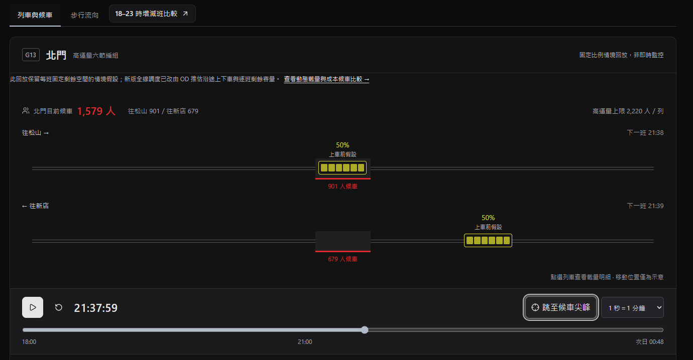
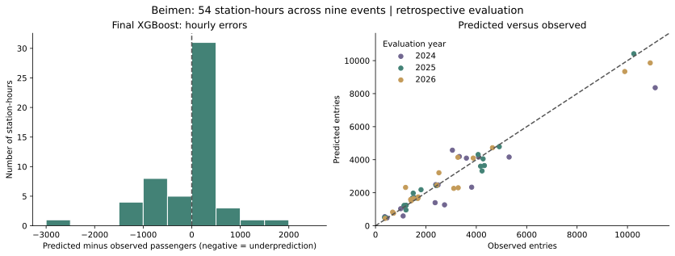
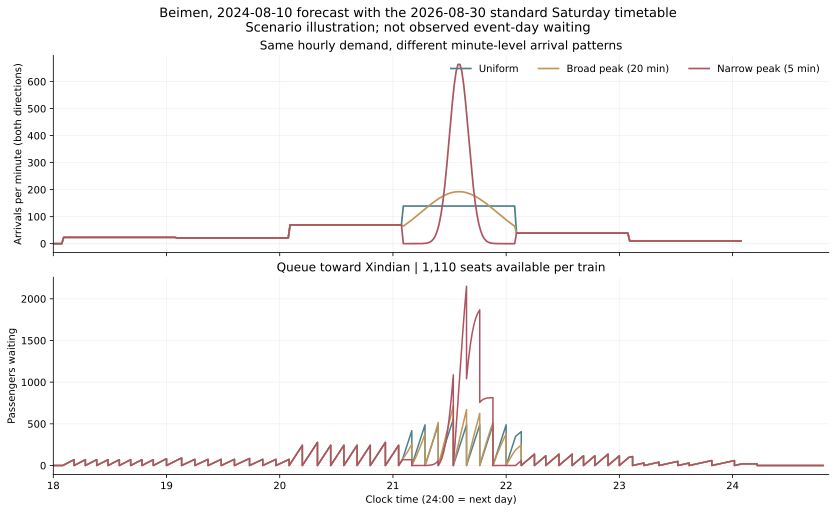
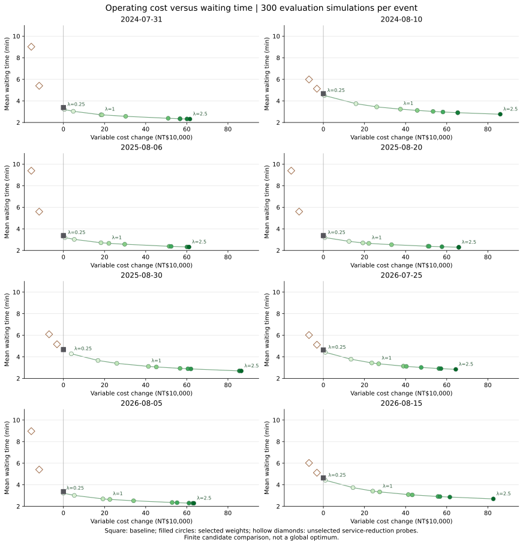
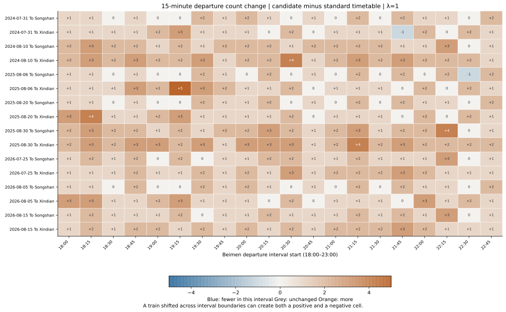

# 大稻埕煙火人流分析與捷運班次模擬

*DEMO 展示範例：點圖進入網站。畫面中的列車位置與候車人數是模型回放，不是即時監測或活動當日實測。*

[公開網站](https://shu-ming0808.github.io/Statistical-Practice-final/) · [詳細預測與活動模擬班表](https://shu-ming0808.github.io/Statistical-Practice-final/#/research) · [班次決策](https://shu-ming0808.github.io/Statistical-Practice-final/#/research?tab=dispatch) · [英文研究論文 PDF](output/pdf/Dadaocheng_Metro_Demand_and_Timetable_Research_Manuscript.pdf)

## 研究問題與資料

預測煙火活動期間北門等車站的逐時人流，再把逐時需求拆成分鐘到達情境，估計候車與列車載量，最後比較松山新店線原班表及增班、減班、移時方案的成本與等待。

- **預測資料：**21 場活動，北門、大橋頭、雙連、民權西路，18–23 時，共 504 列。「活動 × 車站 × 時段」是資料列，不是 504 個獨立活動。主要評估為 2024–2026 年九場北門資料，共 54 個時段。
- **輸入：**車站與時段、兩者交互作用、週末、年內日期與年度趨勢、過去 56 日同星期一般日基準，以及事前公告的展演結束時間重疊訊號。當日先前人流、實測天氣和事後聲量不進入這版事前預測。
- **可得性限制：**以活動前一天可用資訊為設計原則，但歷史 OD／日曆的實際發布時間尚未全面核實；九場也曾反覆參與開發。結果是回顧比較，仍需新活動驗證，不能稱為嚴格 D−1 上線績效。

~~~mermaid
flowchart LR
    A["活動資料與過去 OD"] --> B["逐年向前驗證"]
    B --> C["逐時人流預測"]
    C --> D["分鐘到達情境"]
    D --> E["候車與逐站載量模擬"]
    E --> F["班表成本與等待取捨"]
~~~

## 逐時人流預測

### 模型選擇與調參

Ridge 提供可解讀的線性係數與交互作用；GAM 檢查平滑的非線性；XGBoost 學習門檻與條件組合。依年份向前驗證：預測 2024／2025／2026 時只用更早的 12／15／18 場訓練，不隨機拆分同場時段。Ridge 比較 25 個收縮強度、GAM 比較 60 組平滑與基底設定、XGBoost 比較 180 組預先定義的候選，另檢查學習率、樹數及 early stopping；每項前處理都只用訓練折擬合。這不是所有參數的完整笛卡兒積搜尋。

北門散場常低估，因此另外比較「散場低估加倍計罰」的選參規則與「提高散場訓練列權重」。最後保留原樹設定與散場權重：若事前散場重疊比例為 o，原始訓練權重是 1+3o，再使每場平均權重為 1。前者是評分規則，後者是訓練樣本權重，兩者不能混為一談。固定這個選擇曾參考同九場結果，不能宣稱完全獨立選模。

| 評估年度 | Ridge λ | GAM 平滑／係數懲罰／基底 | XGBoost 樹深／樹數／學習率 |
|---|---:|---|---|
| 2024 | 0.000177828 | 0.1／0.001／5 | 3／250／0.10 |
| 2025 | 0.177827941 | 0.1／0.001／5 | 4／250／0.05 |
| 2026 | 0.177827941 | 0.1／0.001／7 | 4／250／0.05 |

XGBoost 其餘設定為 min_child_weight=1、reg_lambda=1、reg_alpha=0、subsample=1、colsample_bytree=1，使用平方誤差與 hist。early stopping 未納入最後模型。[凍結設定](configs/forecast.json) · [候選格點與選參紀錄](result/forecast/tuning_record.json)

### 最後比較結果

相同九場北門、54 個時段，單位為人次／時段；誤差越低越好。

| 模型 | MAE | RMSE | 實際尖峰時段平均絕對誤差 | 散場窗口低估 |
|---|---:|---:|---:|---:|
| Ridge | 845.44 | 1,547.49 | 2,681.26 | 1,413.98 |
| GAM | 830.71 | 1,315.75 | 2,305.11 | 1,132.68 |
| XGBoost 未加權 | 473.91 | 766.90 | 749.02 | 405.96 |
| **XGBoost 散場加權** | **440.28** | **690.91** | **747.14** | **483.61** |

加權後整體 MAE 相對未加權改善約 7.1%，**散場窗口低估卻增加**。2024/8/10 的最高峰實際 11,101、預測約 8,359，仍少估 2,742 人次。整體平均改善不能解讀為尖峰問題已解決。

負誤差表示低估；[九場逐時走勢](result/forecast/figures/hourly_profiles.png)可檢查峰值時間。曾比較只留部分車站、一般日增量、lag、融合及不同縮放；沒有取得足以取代目前 XGBoost 的一致改善。Lasso 的弱懲罰設定幾乎等於未篩變數，較強懲罰則使預測變差；隊友線性實驗屬未完整重現的探索性核對，詳見[獨立報告](result/linear_sensitivity/report.md)。輸入相關性與 VIF 只作診斷，不直接決定樹模型要刪哪些變數；[相關圖與定義](result/forecast/report.md)。

### 解釋性模型

Ridge 用標準化設計向量 z（含車站、時段與交互作用）：

$$
(\hat\beta_0,\hat\beta)
=\arg\min_{\beta_0,\beta}
\left(\frac1n\sum_i(y_i-\beta_0-z_i^\top\beta)^2+\lambda\lVert\beta\rVert_2^2\right),
\qquad \hat y=\max(0,\hat\beta_0+z^\top\hat\beta).
$$

截距不懲罰。2026 折 n=432、λ=0.177827941，故實作的 sklearn alpha=nλ=76.8216705。該折的週末係數約 +278.50；一般日基準增加一個訓練標準差（約 709.71 人次）的係數約 +532.87。這是控制其他欄位後的**預測關聯**，不是因果效果；完整公式需加入所有係數、補值與標準化常數。[完整係數](result/forecast/tables/ridge_coefficients_2026.csv) · [可重算公式](result/forecast/ridge_equation_2026.json)

GAM 使用加法平滑與懲罰，資料支持不足的欄位維持線性；XGBoost 的分裂增益也不是因果影響。融合模型曾測試等權與學習權重，未穩定勝過單一 XGBoost，因此未採用。[完整模型報告](result/forecast/report.md) · [實作細節](process.md)

## 分鐘候車與列車載量

公開進出站資料最細是小時。對每小時預測人數先設分鐘權重 p，使各分鐘加總仍等於原小時預測；比較均勻、寬峰、集中峰及峰中心。進站後到月台另假設固定 5 分鐘。方向比例、分鐘形狀與北門前的列車剩餘空間均做情境分析，**不是量到的分鐘人流或候車時間**。列車以批次服務隊伍；同方向若有人跨班滯留，已用滿該班可用容量。

高運量六節編組的名目上限是 2,220 人，不能直接當北門可上車人數。全線調度使用歷史 OD、假設路徑與班表，逐站先下後上推估車上人數；仍缺與活動相符的逐班實測載量校準。[候車情境報告](result/queue_dispatch_v1/report.md) · [逐班剩餘空間](result/green_dispatch_diagnostics/figures/beimen_remaining_capacity.png) · [校準資料缺口](result/green_load_profile/calibration/report.md)

事後檢查顯示 2024/8/10 預測 18,115、實際 26,423 人次時，在固定情境下候車量約由 65,516 變成 95,520 人分鐘。這只說明預測誤差可能傳到候車；事後人數沒有進入事前預測或班表選擇。[逐場回顧](result/queue_replay/report.md)

## 松山新店線班表方案

僅調整 18:00–23:00 松山新店線北門離站時刻，允許增班、取消與移時；其他線原班表不動，另評估原四站的轉乘影響。用 2026/8/30 生效的一般班表作**研究基準**，它不是 2024–2026 各活動當日的實際營運紀錄。兩分鐘最短班距也是研究假設，並非經核實的號誌安全下限。

研究目標把相對原班表的可變支出與乘客候車時間價值相加：

$$
\min_{x\in\mathcal P}
\left(\Delta C_{\mathrm{op}}(x)
+\lambda\frac{196}{60}\frac1S\sum_{s=1}^{S}W_s(x)\right).
$$

x 是有限候選班表，W 是模擬候車人分鐘，λ 是研究者設定的偏好；196/60 元／人分鐘由 2026 最低時薪換算，**不是實測候車價值**。營運成本用 128.05 元／列車公里代理及 18.77 km 全線長度；新增服務另假設一次同長空車回送，取消服務只扣可避免的單程成本，未涵蓋真實整備、司機與機廠限制。每組以 200 次訓練情境選班表，再用 300 次獨立情境評估。原班表包含在候選內；找到的是有限候選中的較佳方案，沒有全域最優保證。

目前逐一重算 λ=0.25、0.5、…、2.5 的十組偏好，沒有由資料推得唯一「正確 λ」。八場加總結果：

| 方案 | 相對原表支出差 | 乘客加權平均候車 | 真正增／減／移時 |
|---|---:|---:|---:|
| 原班表 | 0 元 | 3.895 分 | 0／0／0 |
| λ=0.25 | +81,719 元 | 3.688 分 | +20／−6／562 |
| λ=1 | +2,187,184 元 | 2.901 分 | +455／−0／622 |
| λ=2.5 | +5,715,519 元 | 2.481 分 | +1,189／−0／509 |

因此 λ=1 的方案**多花營運費用換取較短候車**，不能稱作現金節省。低權重時才選到少量取消班次；背景旅次多且候選搜尋也偏向密班，兩者都可能推動增班。8／10 分鐘配置可減少支出，但目前只作診斷，未正式採用。

熱圖橘色表示該時段班次較多、藍色較少；**移時也會形成一正一負兩格，藍格不等於取消一班**。[逐場結果與完整方法](result/green_dispatch/report.md) · [各權重與減班診斷](result/green_dispatch_diagnostics/report.md) · [逐班時刻](result/green_dispatch/timetable.csv) · [四站影響](result/green_dispatch/station_impacts.csv)

**目前限制：**OD 時段與實際到站分鐘、乘車路徑、車上載量仍是推估；其他線車上容量、備車、司機及折返尚未完整納入。網站上的「活動模擬班表」展示模型建議，不是可直接執行的調度命令。

## 重現與網站更新

私有逐列資料、模型與官方原檔保存在 .local/，不會推送到 GitHub。沒有這些檔案仍可查看 README、公開英文 SVG 圖表、報告與網站；重跑需由團隊私下取得相同快照，先核對雜湊。README 圖表使用可縮放的 SVG，另有高解析度 PNG 備用；圖表可從公開結果以 `python scripts/render_readme_figures_en.py` 重畫。頁首 DEMO 是網站畫面截圖，仍是點陣圖。

~~~powershell
uv sync --inexact --extra transit --group analysis
uv run --extra transit --group analysis python -X utf8 src/run_forecast.py
uv run --extra transit --group analysis python -X utf8 src/run_green_dispatch.py --reuse
uv run --extra transit --group analysis python -X utf8 -m app.export_dispatch
npm.cmd --prefix app/frontend test
npm.cmd --prefix app/frontend run build
~~~

預測入口重現凍結模型，不自動選新參數；調度快照重新輸出後才會更新公開網站。[完整指令、輸入與驗證](process.md) · [前端與 GitHub Pages](app/README.md)

## 專案結構

~~~text
統計實務/
├── README.md、process.md        # 結論與可重現細節
├── configs/                     # 凍結預測、調度設定
├── src/                         # 清理、預測、分鐘候車、班表搜尋
├── result/                      # 公開報告、圖與彙總表
├── app/                         # 網站、公開快照與匯出程式
├── docs/                        # 資料來源、公式、資料庫結構
├── data/                        # 本機原始與處理資料
├── .local/                      # 私有快照、模型與官方原檔
└── tests/                       # 資料、模型與網站檢查
~~~

## 詳細說明與參考資料

- [資料前處理](docs/data_preprocessing.md) · [資料庫結構](docs/database_schema.dbml) · [DuckDB／MySQL 實測](result/duckdb_benchmark/README.md)：本機 2026/7 的 8,366,652 筆 OD 彙總由 DuckDB 較快；小範圍索引查詢由 MySQL 較快，不能推廣為所有工作負載。
- [官方班表、來源版本與調度限制](docs/metro_operations.md) · [北門一般假日基準](result/queue_dispatch_v1/beimen_holiday_baseline.csv) · [中文理論與證明 PDF](output/pdf/大稻埕人流預測與列車調度_理論與證明.pdf)
- [北捷分時進出站運量](https://data.taipei/dataset/detail?id=63f31c7e-7fc3-418b-bd82-b95158755b4d) · [特殊節假日](https://data.gov.tw/dataset/14718) · [大稻埕活動資料](https://data.gov.tw/dataset/7778) · [氣象署 CODiS](https://codis.cwa.gov.tw/StationData)
- [Threads 蒐集說明](docs/threads_collection.md) · [PTT 蒐集說明](docs/ptt_collection.md) · [Google Trends](mysql/GOOGLE_TRENDS_README.md)：社群與搜尋資料只作探索，沒有進入凍結的人流預測模型。
- [四站官方時刻表](result/queue_dispatch_v1/metro_source_snapshot.csv) · [高運量六節編組容量](https://www.dorts.gov.taipei/News_Content.aspx?n=2A66A485FACB0D5B&s=F32662CFF6FE4D80) · [官方站間行車時間](https://data.taipei/dataset/detail?id=513e97fe-6a98-4a0d-b7dc-11122c8638d4) · [捷運距離來源](https://data.taipei/dataset/detail?id=4acb4911-0360-4063-808d-fcee629508b3)
- [北捷年度成本資料](https://www.metro.taipei/cp.aspx?n=20CB8DE3F41B4111) · [公里數資料](https://whhr.gov.taipei/News_Content.aspx?n=0121E4C78246FC0D&s=3E147DD6A74BE990) · [2026 年最低時薪](https://www.mol.gov.tw/1607/28690/2282/2284/2290/7121/)
- [Hoerl 與 Kennard（1970）：Ridge](https://doi.org/10.1080/00401706.1970.10488634) · [Hastie 與 Tibshirani（1986）：GAM](https://doi.org/10.1214/ss/1177013604) · [Chen 與 Guestrin（2016）：XGBoost](https://arxiv.org/abs/1603.02754) · [Hyndman 與 Athanasopoulos：向前驗證](https://otexts.com/fpp3/tscv.html)
- [Santanam 等（2021）：活動人流與列車模擬](https://arxiv.org/abs/2106.05359) · [Mo 等（2020）：容量限制下的軌道載客](https://journals.sagepub.com/doi/abs/10.1177/0361198120914309) · [完整文獻與適用界線](docs/references.md)
