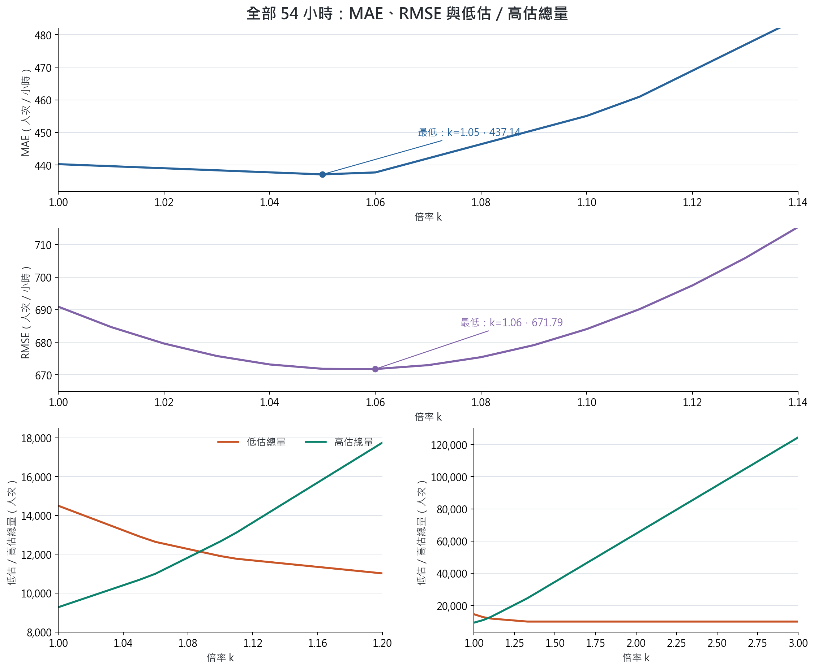
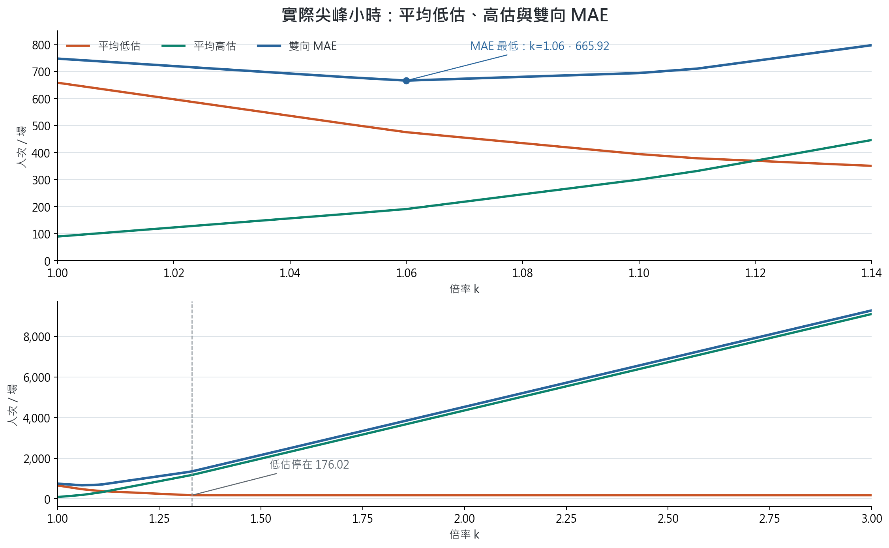

# 北門分鐘權重倍率整合報告

## 結論摘要

- 對封存 XGBoost 預測的**每場預測最高小時**乘以 `k`，在九場、54 小時的資料內，全部小時 MAE 以 **`k=1.05`** 最低（437.14；原設定 440.28）。只看九場的**實際尖峰小時雙向 MAE**，則以 **`k=1.06`** 最低（665.92；原設定 747.14）。
- 單邊的「實際尖峰低估」不能獨立拿來選 `k`。到 `k=1.33`，平均低估降至 176.02，但平均高估升至 1,172.89，雙向 MAE 反而達 1,348.91。
- 當模型預測最高時段與實際最高時段不同，本實驗只放大前者，因此實際最高時段的預測沒有變；該時段的低估、高估和絕對誤差都維持不變。
- **兩種 MAE 的評估小時與分母不同，數值不能互相比大小；只能在同一指標內比較不同 `k`。**實際尖峰的平均低估和平均高估則取自同九個小時，可以相加為該指標的 MAE。
- `k=1.05` 是這九場的**資料內校正結果**，不是原模型必須使用 5% 的物理定律，也尚未證明可改善新活動。下文先交代模型與倍率，再用雙向指標、逐場誤差及時段錯位說明這個選擇。

## 實驗怎麼做

資料是北門九場活動在 18–23 時的封存預測及實際人流，共 54 筆。每場先用**預測值**找出最高的小時，只將該小時的 60 個分鐘權重乘以倍率 `k`；其餘五小時維持原預測。掃描 `k=1.00–3.00`，間隔 0.01，沒有重新訓練模型。

原本 60 個分鐘權重合計為 1；乘上 `k` 後合計為 `k`。因此這項實驗不只是改變分鐘內的人流形狀，還會把選中小時的**預測總人次也乘以 `k`**。σ=5 或 20 分鐘只決定分鐘分布的寬窄，不影響下面的逐時誤差。

### 三種評估位置，不要混用

每場先分清兩個小時：`p` 是**原預測最高小時**，`a` 是**實際人數最高小時**。本實驗只把 `p` 小時的預測乘以 `k`；若 `p≠a`，`a` 小時的預測完全不變。下文的數字依評估位置分成三種：

| 評估位置 | 筆數與計算方式 | 報告中的用途 |
|---|---|---|
| 全部小時 | 九場各六小時，共 54 筆；每筆低估 `max(實際−預測, 0)`、高估 `max(預測−實際, 0)`，各自加總；MAE 是 54 筆絕對誤差的平均 | 比較「小時 MAE」及「逐時低估／高估總量」 |
| 實際尖峰小時 `a` | 每場只取實際最高的那一小時，共九筆；各筆低估、高估依同一公式計算，分別加總除以九；兩個平均值相加就是該小時的 MAE | 比較「實際尖峰平均低估／高估」及「實際尖峰小時 MAE」 |
| 預測尖峰小時 `p` | 每場只取原預測最高的那一小時，共九筆 | 只用來說明哪個小時被 `k` 放大，以及原本有幾場低估／高估 |

**「四場低估、五場高估」只指 `k=1.00` 時的預測尖峰小時 `p`，不是實際尖峰小時 `a`。**在 `a` 小時，原本是**五場低估、四場高估**：2025-08-06 在預測尖峰 20 時高估，但在實際尖峰 21 時低估。兩種場次數不能直接拿來解釋另一種指標。

### k 代表的實際意義

若某場預測最高小時原本是 `P` 人次，倍率 `k` 會多加 `(k−1)P` 人次。九場的 `P` 平均為 **6,648.66**，所以 `k=1.06` 平均每場多預測約 **399** 人次，`k=1.10` 約多 **665** 人次；它們並非把整場六小時人流都增加 6% 或 10%。此時乘過 `k` 的分鐘數值已不是「合計為 1 的分配比例」，較合適的解讀是對**預測尖峰小時需求加一個校正或保守緩衝**。沒有實測分鐘抵達資料，不能把選出的 `k` 解讀為真實分鐘分布的參數。

## 倍率增加的實際效果

先看**全部 54 小時**的誤差。每個小時只計入低估或高估其中一邊；兩邊總量相加再除以 54，就是小時 MAE。以下單位均為人次。

下表保留各倍率的精確數值：

| k | 全部 54 小時 MAE | 全部 54 小時 RMSE | 54 小時低估總量 | 54 小時高估總量 |
|---:|---:|---:|---:|---:|
| 1.00 | 440.28 | 690.91 | 14,501.39 | 9,273.82 |
| 1.03 | 438.40 | 675.78 | 13,552.99 | 10,120.57 |
| 1.04 | 437.77 | 673.19 | 13,236.86 | 10,402.82 |
| 1.05 | **437.14** | 671.86 | 12,920.73 | 10,685.07 |
| 1.06 | 437.75 | **671.79** | 12,637.81 | 11,000.53 |
| 1.07 | 442.08 | 672.98 | 12,455.61 | 11,416.70 |
| 1.08 | 446.41 | 675.43 | 12,273.40 | 11,832.88 |
| 1.09 | 450.75 | 679.12 | 12,091.20 | 12,249.05 |
| 1.10 | 455.08 | 684.04 | 11,909.00 | 12,665.23 |
| 1.11 | 460.97 | 690.15 | 11,768.89 | 13,123.50 |
| 1.12 | 468.96 | 697.43 | 11,685.30 | 13,638.29 |
| 1.20 | 532.84 | 792.70 | 11,016.57 | 17,756.60 |
| 1.33 | 637.26 | 1,044.50 | 9,946.48 | 24,465.43 |
| 1.50 | 825.64 | 1,459.18 | 9,946.48 | 34,637.88 |
| 2.00 | 1,379.69 | 2,833.50 | 9,946.48 | 64,556.85 |
| 3.00 | 2,487.80 | 5,707.07 | 9,946.48 | 124,394.80 |

### 實際尖峰小時：九場各取一小時

下圖**只看每場實際人數最高的小時 `a`，共九筆**。每場的低估是 `max(實際ₐ−預測ₐ(k), 0)`，高估是 `max(預測ₐ(k)−實際ₐ, 0)`；兩者各自加總除以九。若 `p≠a`，該場的 `預測ₐ(k)` 不隨 `k` 改變。

下表保留各倍率的精確數值：

| k | 九場實際尖峰小時平均低估 | 九場實際尖峰小時平均高估 | 九場實際尖峰小時 MAE＝兩者相加 |
|---:|---:|---:|---:|
| 1.00 | 658.01 | 89.13 | 747.14 |
| 1.03 | 566.14 | 139.60 | 705.75 |
| 1.04 | 535.52 | 156.43 | 691.95 |
| 1.05 | 504.90 | 173.25 | 678.15 |
| 1.06 | 475.06 | 190.86 | **665.92** |
| 1.07 | 454.81 | 218.06 | 672.87 |
| 1.08 | 434.57 | 245.26 | 679.83 |
| 1.09 | 414.32 | 272.47 | 686.79 |
| 1.10 | 394.08 | 299.67 | 693.75 |
| 1.11 | 378.51 | 331.55 | 710.06 |
| 1.12 | 369.22 | 369.71 | 738.93 |
| 1.20 | 294.92 | 674.98 | 969.90 |
| 1.33 | 176.02 | 1,172.89 | 1,348.91 |
| 1.50 | 176.02 | 1,979.48 | 2,155.50 |
| 2.00 | 176.02 | 4,351.82 | 4,527.84 |
| 3.00 | 176.02 | 9,096.50 | 9,272.52 |

以下只看每場**實際尖峰小時 `a`**，共九筆。`k=1.00` 時，五場低估、四場高估。九場中有四場的預測尖峰 `p` 與 `a` 不同：2024-07-17、2024-07-31 在 `a` 小時高估；2025-08-06、2025-08-20 在 `a` 小時分別低估 **908.36**、**675.83**。其餘五場 `p=a`，其中三場低估、兩場高估。2025-08-06 雖然在預測尖峰 20 時高估，實際尖峰 21 時仍是低估，這是兩種場次數不同的原因。

倍率只放大 `p` 小時。到 `k=1.33`，三場 `p=a` 的低估已歸零；兩場 `p≠a` 的低估仍固定，因為它們的 `a` 小時預測沒有改。所以**九場實際尖峰平均低估**是 `(908.36+675.83+其餘七場的 0)/9=176.02`，分母是全部九場。高估不拿來抵銷低估，而是另算平均 **1,172.89**；兩者相加的雙向 MAE 為 **1,348.91**。因此 176.02 只表示低估剩多少，不能表示整體預測變準。

### 為何只需要小幅校正

原始的四站散場加權 XGBoost 已根據車站、時段、預定散場比例及背景人流預測每小時人數；訓練權重只影響模型擬合，並非將預測乘上倍數。本實驗的 `k` 是預測完成後，只放大各場「預測最高小時」的輸出。模型沒有當場實際到場人數與離場時間，極端人流仍可能低估，因此有小幅補正空間。

但這九個**預測尖峰小時 `p`**原本有四場低估、五場高估。與未加權 XGBoost 相比，加權模型在這九小時平均少預測 497.73 人；乘 1.05 只平均加回 332.43 人，能補回部分低估，卻也會使已高估場次更差。九場的全部 54 小時 MAE 因而由 440.28 小降至 437.14；倍率再加大，高估增加會抵銷改善。`1.05` 是這九場依全部小時 MAE 算出的資料內最佳格點，不能解讀為模型每場固定少算 5%，也尚未證實適用於新活動。

## 如何解讀最佳倍率

選倍率時應並列**全部 54 小時 MAE**、**九場實際尖峰小時 MAE**及同九個小時的平均低估／高估。單邊低估指標不處罰高估，倍率夠大時自然會下降或持平，**不能單獨拿來選最佳倍率**。固定 1.05 倍雖使全部小時 MAE 略降，卻讓其中 **五場各自六小時的 MAE** 變差；每次留出一場、用其他八場選倍率後，整體 MAE 為 **471.64**，高於原設定的 **440.28**。只用過去年份選倍率時，2025 與 2026 都選回 **1.00**。這九場曾參與原模型開發，又沒有實測的分鐘抵達資料，因此 1.05、1.06 與 1.10 都只是這九場資料內的取捨，尚非新活動或候車模擬已驗證的設定。

從九場資料可以提出幾個**可能原因，尚不能當成已證實的機制**：

- 大型活動的尖峰可能較難預測：實際尖峰超過 9,000 人次的四場中，按**實際尖峰小時 `a`**計算，三場原本低估、一場高估。這可能與高人流訓練例子較少、模型把極端值拉向常見水準有關；四場不足以確認原因。
- 兩場 2025 年活動的預測尖峰在 20 時、實際尖峰在 21 時。統一放大 20 時不能解決時段錯位，這解釋了部分尖峰低估為何維持不變。
- 固定同一個 `k` 套用所有活動，會同時放大原本已高估的**預測尖峰小時 `p`**。九場中有五場在 `p` 小時原本就高估，故倍率太大會推高**全部 54 小時 MAE**；是否需要依活動條件採不同倍率，必須另用獨立活動驗證。

## 資料與計算依據

本報告使用封存的北門九場逐時預測及真值，共 54 筆；預測檔 SHA-256 為 `96915ef02b9ebbf6fae909209f85b65cd9da1f2682dc87497d198bdb53daf3ef`。模型與倍率掃描沒有重新訓練。完整格點、逐場效果及尖峰時段資料分別見[倍率掃描](sweep.csv)、[逐場 MAE 變化](event_effects.csv)與[實際尖峰對照](actual_peak_breakdown.csv)。
