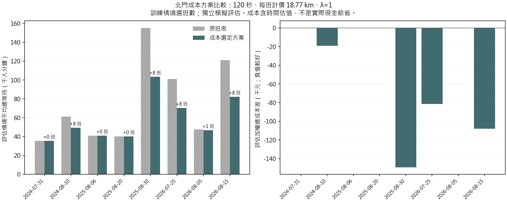
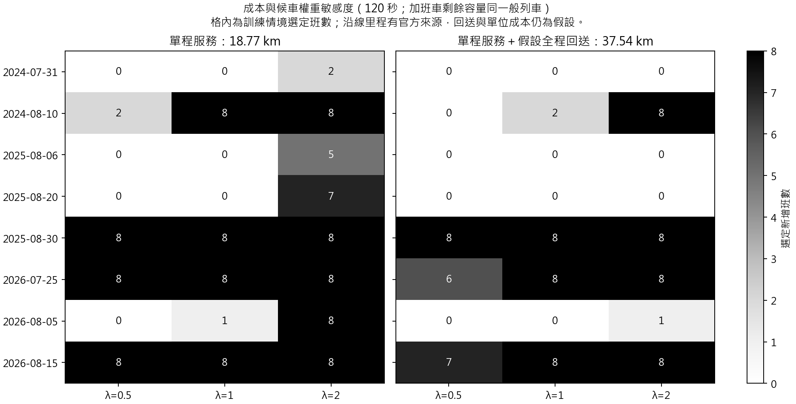

# 北門增班成本與候車加權比較

**保留原班表，在每個班數的啟發式方案中選加權總成本最低者。不是完整重排班表、全域最佳證明或可直接執行的調度命令。**

## 方法與輸入

- 固定原四站加權 XGBoost 北門預測；只借用日期早於目標活動的誤差。2024-07-17 沒有較早誤差而跳過，其餘八場可用 1–8 場誤差；不得把模擬次數當獨立活動樣本數。
- 每場 200 次訓練情境搜尋 0–8 班方案，再從訓練成本選班數；另外 300 次情境只用來評估，沒有用其結果改選方案。各成本／權重共用同一批亂數情境。
- 均勻、寬峰、集中峰各 1/3；方向 40–60%、一般班次剩餘容量 25–75%、Poisson 分鐘到達。加班車比較同一般剩餘容量與 90% 空間兩種情境。
- 同方向新增與原有／新增班次相隔至少 120 或 180 秒，連 18:00 前最近原班也檢查；不移動原班。120／180 秒不是已核實的號誌安全極限。
- 共同評估終點為 18:00 後 420 分鐘，末班後仍累計等待；未疏運者額外每人加 60 分鐘的研究懲罰。

$$J(x)=un(x)L+\lambda v\frac1S\sum_{s=1}^S[W_s(x)+60R_s(x)].$$

- $u=128.05$ 元／列車公里沿用使用者提供值，車公里口徑及年度尚未核實。松山—新店逐站加總為 18.77 km；比較僅計單程服務 $L=18.77$，及假設另有一次全程空車回送 $L=37.54$ km。每加一班服務列車才計一次成本；回送不計為額外服務班次，也未模擬其載客效益。
- [官方最短站間距離](https://data.taipei/dataset/detail?id=4acb4911-0360-4063-808d-fcee629508b3)不能直接用端點距離代替營運路線；本版依官方綠線順序加總相鄰站。車庫、折返及實際回送里程未知，沒有把未知值當實測零。單程情境只計已知服務部分；雙程也不是完整成本上界。[計算與資料庫紀錄](../metro_distances/report.md)
- $v=196/60$ 元／人分鐘沿用前述時間價值代理；$\lambda=0.5,1,2$ 表示偏好，不是從測試資料擬合。不是北捷支付給乘客的費用。
- $W_s$ 是雙方向整段時間的總候車人分鐘，$R_s$ 是期末未疏運人數。模型比較的是期望總量，不是各情境候車中位數。
- 固定班數且每班價格相同時，加成本不改變班次位置搜尋；在 0–8 班之間以成本選擇。評估成本比原班表高時仍照實報告，不用評估資料事後退回原班表。

## 參考情境結果

120 秒、一般剩餘容量、每班計價 18.77 km、λ=1（僅計服務里程）。這些是試算條件，**不是經核實的最佳營運設定**。

| 活動 | 過去誤差場數 | 選定增班 | 增班費用（元） | 平均等待中位數：原→新（分） | 評估加權總成本差（元） |
|---|---:|---:|---:|---|---:|
| 2024-07-31 | 1 | 0 | 0 | 2.72 → 2.72 | +0 |
| 2024-08-10 | 2 | 8 | 19,228 | 3.62 → 3.23 | -19,227 |
| 2025-08-06 | 3 | 0 | 0 | 2.70 → 2.70 | +0 |
| 2025-08-20 | 4 | 0 | 0 | 2.70 → 2.70 | +0 |
| 2025-08-30 | 5 | 8 | 19,228 | 3.91 → 3.27 | -149,322 |
| 2026-07-25 | 6 | 8 | 19,228 | 3.63 → 3.20 | -81,450 |
| 2026-08-05 | 7 | 1 | 2,403 | 2.76 → 2.73 | +253 |
| 2026-08-15 | 8 | 8 | 19,228 | 3.66 → 3.21 | -107,900 |

總成本差＝新方案減原班表；負值表示在此估值下較好，並非營運現金節省。平均等待的中位數僅供解讀，選班數仍使用平均總等待人分鐘。





## 與組員結果的關係及限制

- 組員原版本借用其他八場（含較晚活動）的誤差；此版排除未來場。因此不應直接用兩份報告的數字當成單純加成本的效果。兩邊都沒有重訓人流模型。
- 僅依活動日期限制誤差；原始資料實際發布時間尚未全面核實。仍使用 2026/8/30 一般班表對歷史需求，不是歷史實際班表重建或已驗證嚴格 D−1 部署。
- P95 10 分鐘／5% 並非本版硬限制；這版最小化成本。所有 P95 超標比例均為假設分布下的模擬頻率，不是現場風險機率或校準信賴區間。
- 未接起站發車、備車、司機、折返、整條路線衝突及動態滾動更新；只以松山—新店全程服務估成本，沒有驗證列車能依時抵達北門。官方路線里程仍是相鄰站最短距離加總的近似值；完整新增里程及邊際成本未核實。此版不宣稱可執行營運。
- 找到的是既有候選啟發式方案中的最小值；若選到 8 班，可能仍受搜尋上限影響。沒有證明全域最佳，也不能把無達標方案寫成已證明必須超過 8 班。

## 重跑

```powershell
uv sync --inexact --extra transit --group analysis
uv run --extra transit --group analysis python -X utf8 src/run_dispatch_cost.py
```

需要私下取得 `.local/forecast/predictions.csv` 與 `.local/transit_reference/20261015/` 原始官方快照；來源雜湊會核對。Git 不包含私有輸入。

[成本候選比較](candidates.csv)／[選定方案及評估](selected_plans.csv)／[各班數時刻](plans.csv)／[跳過場次](skipped.csv)／[計算設定](../../configs/dispatch_cost.json)／[來源與稽核](audit.json)
