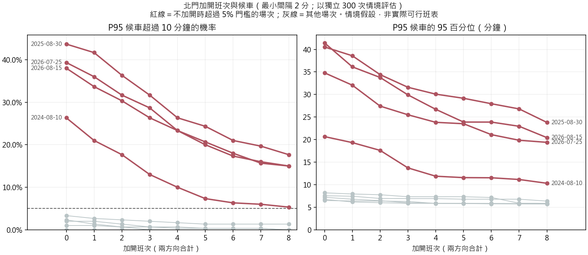

# 北門加開班次敏感度：加開上限 8 班、加開列車容量同一般班次

**在假設情境下求「加開幾班、插在哪一分鐘」的啟發式解；用另一批獨立情境評估。不是可直接上線的班表：車隊、司機、折返、出庫就緒與號誌最小班距都未核實。**

## 1. 問題設定

| 項目 | 設定 |
|---|---|
| 決策 | 每場加開 0–8 班（兩方向合計），每班插在哪個整數分鐘 |
| 限制 | 與同方向任何一班至少相隔 2 分鐘（假設值，另做敏感度）；只能在 18:00 後 0–365 分鐘內插入 |
| 加開列車容量 | 與該情境的一般班次剩餘空間相同（保守；空車折返可能更多） |
| 目標 | 200 個最佳化情境的平均總等待人分鐘最小；末班仍未上車者每人計 60 分鐘懲罰 |
| 解法 | 逐班貪婪插入，再逐班移動到更好位置直到無法改善；小型問題已與窮舉最佳解比對一致 |
| 評估 | 另外 300 個獨立情境，計算平均候車、P95 與「P95 超過 10 分」機率 |

情境抽法與候車不確定性模擬相同：其他場次的實際／預測比例、三種分鐘形狀、Poisson 到達、方向比例與剩餘容量。

## 2. 結果（最小間隔 2 分）

| 活動 | 不加開：P95>10 分機率 | 最少加開幾班可降到 ≤5% |
|---|---:|---:|
| 2024-07-17 | 1.0% | 0 |
| 2024-07-31 | 3.3% | 0 |
| 2024-08-10 | 26.3% | >8 班 |
| 2025-08-06 | 0.0% | 0 |
| 2025-08-20 | 2.3% | 0 |
| 2025-08-30 | 43.7% | >8 班 |
| 2026-07-25 | 39.3% | >8 班 |
| 2026-08-05 | 2.0% | 0 |
| 2026-08-15 | 38.0% | >8 班 |

各場加開位置（最小間隔 2 分）：

| 活動 | 加開數 | 往松山 | 往新店 | 平均候車中位數 | P95 中位數（95%） | P95>10 分機率 |
|---|---:|---|---|---:|---:|---:|
| 2024-07-17 | 0 | — | — | 2.72 | 5.79（6.49） | 1.0% |
| 2024-07-17 | 1 | 21:40 | — | 2.68 | 5.73（6.39） | 1.0% |
| 2024-07-17 | 2 | 21:40 | 20:33 | 2.64 | 5.69（6.36） | 0.7% |
| 2024-07-17 | 3 | 20:18 21:40 | 20:33 | 2.61 | 5.64（6.29） | 0.7% |
| 2024-07-17 | 4 | 20:18 21:40 21:53 | 20:33 | 2.58 | 5.57（5.83） | 0.3% |
| 2024-07-17 | 5 | 20:18 21:34 21:40 21:53 | 20:33 | 2.55 | 5.55（5.83） | 0.3% |
| 2024-07-17 | 6 | 20:18 21:34 21:40 21:53 | 20:33 21:38 | 2.53 | 5.53（5.76） | 0.3% |
| 2024-07-17 | 7 | 20:18 21:34 21:40 21:53 | 20:33 21:21 21:38 | 2.51 | 5.51（5.73） | 0.3% |
| 2024-07-17 | 8 | 20:18 21:34 21:40 21:53 | 20:33 20:50 21:21 21:38 | 2.48 | 5.47（5.71） | 0.0% |
| 2024-07-31 | 0 | — | — | 2.73 | 5.83（8.20） | 3.3% |
| 2024-07-31 | 1 | 21:40 | — | 2.69 | 5.78（7.94） | 2.7% |
| 2024-07-31 | 2 | 21:40 | 20:33 | 2.67 | 5.74（7.77） | 2.3% |
| 2024-07-31 | 3 | 21:34 21:40 | 20:33 | 2.64 | 5.73（7.33） | 2.0% |
| 2024-07-31 | 4 | 20:18 21:34 21:40 | 20:33 | 2.61 | 5.68（7.33） | 1.7% |
| 2024-07-31 | 5 | 20:18 21:34 21:40 | 20:33 21:38 | 2.59 | 5.66（7.33） | 1.3% |
| 2024-07-31 | 6 | 20:18 21:34 21:40 | 20:33 21:21 21:38 | 2.56 | 5.64（7.16） | 1.3% |
| 2024-07-31 | 7 | 20:18 21:34 21:40 21:53 | 20:33 21:21 21:38 | 2.52 | 5.56（5.89） | 1.3% |
| 2024-07-31 | 8 | 20:18 21:34 21:40 21:53 | 20:21 20:33 21:21 21:38 | 2.50 | 5.53（5.87） | 1.3% |
| 2024-08-10 | 0 | — | — | 3.63 | 6.91（20.66） | 26.3% |
| 2024-08-10 | 1 | 21:34 | — | 3.57 | 6.87（19.33） | 21.0% |
| 2024-08-10 | 2 | 21:34 | 21:49 | 3.51 | 6.87（17.61） | 17.7% |
| 2024-08-10 | 3 | 21:34 21:49 | 21:49 | 3.46 | 6.85（13.73） | 13.0% |
| 2024-08-10 | 4 | 21:34 21:49 | 21:35 21:49 | 3.41 | 6.84（11.88） | 10.0% |
| 2024-08-10 | 5 | 21:34 21:49 | 21:28 21:35 21:49 | 3.34 | 6.80（11.57） | 7.3% |
| 2024-08-10 | 6 | 21:20 21:34 21:49 | 21:28 21:35 21:49 | 3.30 | 6.79（11.53） | 6.3% |
| 2024-08-10 | 7 | 21:20 21:34 21:49 | 21:20 21:28 21:35 21:49 | 3.24 | 6.77（11.15） | 6.0% |
| 2024-08-10 | 8 | 21:20 21:34 21:49 | 21:20 21:28 21:35 21:49 21:56 | 3.19 | 6.76（10.31） | 5.3% |
| 2025-08-06 | 0 | — | — | 2.71 | 5.80（6.74） | 0.0% |
| 2025-08-06 | 1 | — | 20:33 | 2.68 | 5.74（6.16） | 0.0% |
| 2025-08-06 | 2 | 20:18 | 20:33 | 2.64 | 5.69（6.00） | 0.0% |
| 2025-08-06 | 3 | 20:18 | 20:33 20:50 | 2.61 | 5.66（5.87） | 0.0% |
| 2025-08-06 | 4 | 20:18 | 20:21 20:33 20:50 | 2.58 | 5.64（5.86） | 0.0% |
| 2025-08-06 | 5 | 20:18 20:34 | 20:21 20:33 20:50 | 2.56 | 5.64（5.85） | 0.0% |
| 2025-08-06 | 6 | 20:18 20:34 | 20:21 20:33 20:44 20:50 | 2.52 | 5.62（5.84） | 0.0% |
| 2025-08-06 | 7 | 20:18 20:34 20:49 | 20:21 20:33 20:44 20:50 | 2.50 | 5.62（5.82） | 0.0% |
| 2025-08-06 | 8 | 20:18 20:34 20:49 | 20:21 20:33 20:44 20:50 20:56 | 2.48 | 5.60（5.81） | 0.0% |
| 2025-08-20 | 0 | — | — | 2.71 | 5.80（7.21） | 2.3% |
| 2025-08-20 | 1 | — | 20:33 | 2.68 | 5.75（6.78） | 1.3% |
| 2025-08-20 | 2 | 20:18 | 20:33 | 2.64 | 5.70（6.46） | 0.7% |
| 2025-08-20 | 3 | 20:18 | 20:33 20:50 | 2.61 | 5.69（5.98） | 0.0% |
| 2025-08-20 | 4 | 20:18 | 20:21 20:33 20:50 | 2.59 | 5.68（5.89） | 0.0% |
| 2025-08-20 | 5 | 20:18 21:41 | 20:21 20:33 20:50 | 2.56 | 5.62（5.85） | 0.0% |
| 2025-08-20 | 6 | 20:18 21:41 21:53 | 20:21 20:33 20:50 | 2.54 | 5.56（5.82） | 0.0% |
| 2025-08-20 | 7 | 20:18 21:41 21:53 | 20:21 20:33 20:44 20:50 | 2.51 | 5.54（5.79） | 0.0% |
| 2025-08-20 | 8 | 20:18 20:49 21:41 21:53 | 20:21 20:33 20:44 20:50 | 2.49 | 5.54（5.76） | 0.0% |
| 2025-08-30 | 0 | — | — | 3.97 | 7.90（40.54） | 43.7% |
| 2025-08-30 | 1 | — | 21:49 | 3.79 | 7.37（38.59） | 41.7% |
| 2025-08-30 | 2 | 21:48 | 21:49 | 3.63 | 7.21（34.40） | 36.3% |
| 2025-08-30 | 3 | 21:48 | 21:28 21:49 | 3.53 | 6.93（31.60） | 31.7% |
| 2025-08-30 | 4 | 21:33 21:48 | 21:28 21:49 | 3.44 | 6.87（30.08） | 26.3% |
| 2025-08-30 | 5 | 21:33 21:48 | 21:20 21:35 21:49 | 3.41 | 6.88（29.16） | 24.3% |
| 2025-08-30 | 6 | 21:19 21:34 21:48 | 21:20 21:35 21:49 | 3.36 | 6.87（27.95） | 21.0% |
| 2025-08-30 | 7 | 21:19 21:34 21:48 | 21:20 21:28 21:35 21:49 | 3.30 | 6.81（26.80） | 19.7% |
| 2025-08-30 | 8 | 21:19 21:34 21:48 21:55 | 21:20 21:28 21:35 21:49 | 3.26 | 6.80（23.80） | 17.7% |
| 2026-07-25 | 0 | — | — | 3.71 | 7.07（34.80） | 39.3% |
| 2026-07-25 | 1 | 21:34 | — | 3.59 | 6.93（32.06） | 36.0% |
| 2026-07-25 | 2 | 21:34 | 21:49 | 3.53 | 6.93（27.42） | 31.7% |
| 2026-07-25 | 3 | 21:34 21:49 | 21:49 | 3.47 | 6.91（25.50） | 28.7% |
| 2026-07-25 | 4 | 21:34 21:49 | 21:35 21:49 | 3.40 | 6.89（23.83） | 23.3% |
| 2026-07-25 | 5 | 21:34 21:49 | 21:28 21:35 21:49 | 3.33 | 6.82（23.52） | 20.0% |
| 2026-07-25 | 6 | 21:19 21:34 21:49 | 21:28 21:35 21:49 | 3.29 | 6.81（21.10） | 17.3% |
| 2026-07-25 | 7 | 21:19 21:34 21:41 21:49 | 21:28 21:35 21:49 | 3.24 | 6.79（19.85） | 16.0% |
| 2026-07-25 | 8 | 21:19 21:34 21:41 21:48 21:55 | 21:28 21:35 21:49 | 3.19 | 6.78（19.39） | 15.0% |
| 2026-08-05 | 0 | — | — | 2.77 | 5.86（7.56） | 2.0% |
| 2026-08-05 | 1 | 21:53 | — | 2.73 | 5.82（7.44） | 2.0% |
| 2026-08-05 | 2 | 21:40 21:53 | — | 2.70 | 5.78（6.95） | 1.3% |
| 2026-08-05 | 3 | 21:40 21:53 | 20:33 | 2.67 | 5.74（6.92） | 0.7% |
| 2026-08-05 | 4 | 20:18 21:40 21:53 | 20:33 | 2.64 | 5.69（6.92） | 0.7% |
| 2026-08-05 | 5 | 20:18 21:40 21:53 | 20:33 21:38 | 2.61 | 5.68（6.78） | 0.3% |
| 2026-08-05 | 6 | 20:18 21:40 21:47 21:53 | 20:33 21:38 | 2.59 | 5.67（6.78） | 0.3% |
| 2026-08-05 | 7 | 20:18 21:34 21:40 21:47 21:53 | 20:33 21:38 | 2.57 | 5.65（6.78） | 0.3% |
| 2026-08-05 | 8 | 20:18 21:34 21:40 21:47 21:53 | 20:33 20:50 21:38 | 2.54 | 5.63（6.36） | 0.0% |
| 2026-08-15 | 0 | — | — | 3.66 | 6.99（41.45） | 38.0% |
| 2026-08-15 | 1 | 21:48 | — | 3.59 | 6.98（36.13） | 33.7% |
| 2026-08-15 | 2 | 21:48 | 21:49 | 3.53 | 6.96（33.77） | 30.3% |
| 2026-08-15 | 3 | 21:34 21:48 | 21:49 | 3.46 | 6.90（29.91） | 26.3% |
| 2026-08-15 | 4 | 21:34 21:48 | 21:35 21:49 | 3.41 | 6.89（26.71） | 23.3% |
| 2026-08-15 | 5 | 21:34 21:48 | 21:28 21:35 21:49 | 3.35 | 6.84（23.89） | 20.7% |
| 2026-08-15 | 6 | 21:19 21:34 21:49 | 21:28 21:35 21:49 | 3.30 | 6.82（23.88） | 18.0% |
| 2026-08-15 | 7 | 21:19 21:34 21:48 21:55 | 21:28 21:35 21:49 | 3.25 | 6.80（22.95） | 15.7% |
| 2026-08-15 | 8 | 21:19 21:34 21:48 21:55 | 21:20 21:29 21:35 21:49 | 3.21 | 6.79（20.43） | 15.0% |

## 3. 界線

- 最小間隔、加開列車容量、分鐘形狀、方向比例與剩餘容量都是假設；結果是「在這些假設下」的條件解。
- 加開列車只算本站一個方向的上車，沒有算回程、車隊與司機，也沒有檢查是否能從機廠或折返站及時到達（見 V1 候選發車站行車時間）。
- 啟發式解法不保證全域最佳；不同場次的加開數彼此獨立求解，沒有共用車隊限制。
- 預測誤差只來自九場，且九場在開發時反覆使用，風險可能被低估。

計畫：[plans.csv](plans.csv)；評估：[evaluation.csv](evaluation.csv)；最少班數：[needed_trains.csv](needed_trains.csv)。
