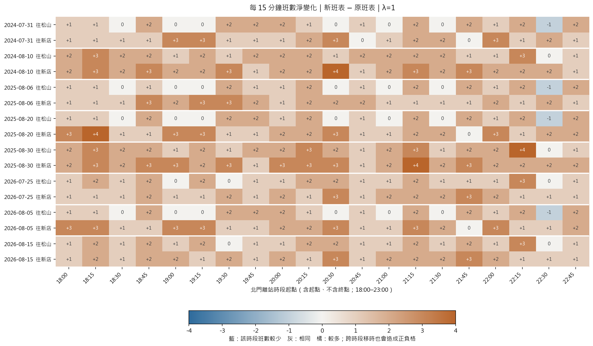

# 18:00–23:00 松山新店線增減班與移時比較

**這是列車載客守恆的回顧模擬與啟發式班表搜尋，不是已證明全域最佳或現場調度命令。**

## 方法

$$\min_{x\in\mathcal P}\;\Delta C_{\rm op}(x)+\lambda\frac{196}{60}\frac1S\sum_s W_s(x).$$

- 原班表包含在候選中；允許增班、減班、前後移時。只選訓練情境中完成疏運的候選。
- 每場 200 次訓練情境，其中前 12 次搜尋與初篩。先保留原搜尋在完整 200 次訓練中各 λ 的勝出方案，再加入 15 分鐘配置候選，以相同訓練情境選擇；獨立 300 次只評估，不反過來選方案。這是新亂數，不是 300 場新的實測活動。
- 移時依最終時刻一對一配對（最多 5 分鐘）；同一移時服務不再被重複算成增班及減班。
- P95 為合併模擬乘客的近似候車分位數，使用分鐘分箱；同組同時到達的背景旅次，其轉乘前等待以加權平均合併，未保留這部分組內變異。不是「情境 P95 超過某門檻的機率」。
- 沿用凍結人流模型，不重新調參。2024-07-17 因沒有較早的同口徑預測誤差，未納入這次八場比較。

$$\Delta C_{\rm op}=128.05\times18.77\times(2N_{\rm add}-N_{\rm remove}).$$

新增服務按完整松山—新店一趟加假設一趟空車回送計費；減班只扣可避免的單程服務費。班數是服務趟次，不是需要的實體車組數。λ=0.5、1、2 表示不同時間價值偏好，不能跨 λ 比較加權總成本來選偏好。

## 獨立模擬評估（λ=1）

| 活動 | 原班數→新班數 | 增／減／移時 | 可變成本差（元） | 平均候車原→新（分） | 總等待變化 |
|---|---:|---:|---:|---|---:|
| 2024-07-31 | 125→175 | +50／−0／87 | +240,350 | 3.38→2.64 | -22.0% |
| 2024-08-10 | 88→166 | +78／−0／65 | +374,946 | 4.67→3.23 | -30.8% |
| 2025-08-06 | 125→176 | +51／−0／83 | +245,157 | 3.38→2.63 | -22.1% |
| 2025-08-20 | 125→183 | +58／−0／88 | +278,806 | 3.38→2.59 | -23.3% |
| 2025-08-30 | 88→174 | +86／−0／59 | +413,402 | 4.67→3.11 | -33.5% |
| 2026-07-25 | 88→144 | +56／−0／68 | +269,192 | 4.64→3.35 | -27.7% |
| 2026-08-05 | 125→182 | +57／−0／87 | +273,999 | 3.36→2.59 | -23.0% |
| 2026-08-15 | 88→148 | +60／−0／71 | +288,420 | 4.64→3.31 | -28.6% |

合計增 496 班、減 0 班、移時 608 班；可變營運成本差 +2,384,271 元，總候車人分鐘變化 -26.4%。負的成本差才是本模型下的可變支出節省；不是實測節省。


## 八場合計與權重敏感度

| λ | 增／減／移時 | 可變營運成本原→新（元） | 平均候車原→新（分） | 總等待變化 |
|---:|---:|---:|---:|---:|
| 0.5 | +169／−0／615 | 2,047,781→2,860,163 | 3.89→3.31 | -15.1% |
| 1 | +496／−0／608 | 2,047,781→4,432,051 | 3.89→2.87 | -26.4% |
| 2 | +1069／−0／520 | 2,047,781→7,186,461 | 3.89→2.53 | -35.1% |

候車改善與營運成本須一起看；若減班未被選中，表示在目前需求、成本與時間估值下，搜尋較偏好保留／增加服務，不代表程式禁止減班。`paired_mc_se` 只衡量固定需求假設下的模擬誤差，不包含路徑、預測或成本參數的不確定性。

## 四站相關旅次的候車拆分（λ=1，八場合併）

| 相關車站 | 綠線平均候車原→新（分） | 可推導紅／橘線段候車原→新（分） |
|---|---:|---:|
| 北門 | 2.66→1.46 | 0.69→0.64 |
| 大橋頭站 | 3.11→1.74 | 2.54→2.36 |
| 雙連 | 2.79→1.57 | 2.53→2.32 |
| 民權西路 | 2.59→1.81 | 1.89→1.72 |

按模擬旅次人數加權。紅／橘線段包含綠線前的候車與可推導後續轉乘；前段班表固定，後續可趕上的班次仍可能改變。這不代表已模擬紅／橘線全線容量或月台排隊。

## 15 分鐘配置與原搜尋的公平比較

將 18:00–23:00 切成 20 個半開時段，分方向嘗試較密、較疏或空的班次配置。這是新增候選的方法；15 分鐘不是列車班距。每個候選均需檢查格外與決策窗外前後班距，並沿用全綠線載客守恆、轉乘與相同成本目標。
候選班距範圍只是有限搜尋設計，沒有把最長 10 分鐘或 5% 風險當成候車合格門檻。原搜尋的各權重訓練勝出方案仍在候選內，擴充後訓練目標不得更差；獨立評估仍可能較差，不能用評估答案換回另一方案。

| 活動 | 原搜尋成本差（元） | 擴充搜尋成本差（元） | 原搜尋平均候車（分） | 擴充搜尋平均候車（分） | 最後候選來源 |
|---|---:|---:|---:|---:|---|
| 2024-07-31 | +249,964 | +240,350 | 2.63 | 2.64 | 15 分鐘配置 |
| 2024-08-10 | +394,174 | +374,946 | 3.21 | 3.23 | 15 分鐘配置 |
| 2025-08-06 | +230,736 | +245,157 | 2.65 | 2.63 | 15 分鐘配置 |
| 2025-08-20 | +254,771 | +278,806 | 2.63 | 2.59 | 15 分鐘配置 |
| 2025-08-30 | +413,402 | +413,402 | 3.11 | 3.11 | 原搜尋 |
| 2026-07-25 | +269,192 | +269,192 | 3.36 | 3.35 | 15 分鐘配置 |
| 2026-08-05 | +264,385 | +273,999 | 2.61 | 2.59 | 15 分鐘配置 |
| 2026-08-15 | +288,420 | +288,420 | 3.32 | 3.31 | 15 分鐘配置 |

兩個成本差皆相對原班表；「原搜尋」指加入分段候選前的搜尋程序，不是原班表。兩者使用同活動、同需求、同訓練／評估亂數、同容量與班距限制。平均候車定義與前表一致。

**8 場合計（λ=1，同批獨立情境）：**

| 指標 | 原搜尋 | 擴充 15 分鐘候選後 |
|---|---:|---:|
| 新增／取消班次 | +492／−0 | +496／−0 |
| 相對原班表的可變支出差（元） | +2,365,043 | +2,384,271 |
| 乘客加權平均候車（分鐘） | 2.8759 | 2.8677 |

擴充候選後，相對原搜尋的可變支出差為 **+19,228 元**，平均候車差為 **-0.49 秒／人**；營運加候車時間價值的加權總成本差為 **-24,852 元**。總成本含換算的候車時間價值，不能當成營運現金支出的節省。
本輪合計仍是增加營運支出換取候車改善，沒有同時降低現金支出。
擴充後實際取消 0 班；熱圖藍格只表示該 15 分鐘格內班數較少，跨格移時也會形成藍格，不能直接解讀為取消整趟服務。
本次已固定一般日 OD 排序，避免轉乘 ID／cohort 次序改變同種子的抽樣對應。表中原搜尋是修正後重跑的同條件對照，不是先前發布的封存數字。

[完整候選方法比較](candidate_family_comparison.csv)／[訓練候選紀錄](training_candidates.csv)

## 每 15 分鐘班數熱圖



橫軸是北門離站時段起點，縱軸是活動與方向。每格為新班表班數減原班表班數：橘色較多、藍色較少、灰色相同。18:15 歸入 18:15–18:30；23:00 不在調整窗內。
**格內正負差不等於實際增班與減班。** 例如一班由 18:14 移到 18:16，兩格分別 −1、＋1，但整晚沒有多一班；費用仍按逐班配對的增、減、移時算。CSV 另列實際新增、取消與移時進出格數，不能把所有正格相加當增班成本。
[逐格原班數、新班數與淨變化](slot_counts.csv)

## 假設與界線

- 只調整北門離站落在 18:00（含）至 23:00（不含）的松山—新店完整服務；其他時段與紅／橘線班表固定。
- 四站採封存年度四站 XGBoost 預測；各場誤差只抽較早活動。其他 OD 採前 56 日內最多六個同星期、非活動日均值。歷史發布時點未全面核實。
- 用官方站間時間推導最短時間路徑；轉乘步行與進站至月台各 5 分鐘均為研究假設。OD 沒有實際轉乘路徑，不能視為觀測。
- 綠線逐站載客守恆，六車容量上限 2,220 人，先下後上，同分鐘旅次比例分配座位。來源 OD 的進站小時以分鐘分布轉為月台到達代理。
- 紅／橘線連接班表由四站官方時刻表與站間時間平移推導，班次不變；可計算錯過下一班的等待，但未重建紅／橘線車上容量。其他路線候車未完整重建。
- 四站影響按出發站優先歸屬；出發站不在四站時再按目的站歸屬，避免重複相加。不經綠線者另列為未調整旅次。
- 17:00–18:00 用一般日 OD 暖機；需求輸入到 23:00，23:00 後固定班次繼續疏運至共同終點 02:00。沒有 P95 10 分鐘／5% 硬門檻，也沒有任意期末 60 分鐘懲罰。
- 平均候車的分母為 17:00–23:00 進站且路徑涉及綠線的模型旅次，包含暖機與一般背景需求；不是北門單站或散場尖峰平均，不能直接與舊版北門剩餘容量情境的平均比較。
- 同向新增或改動班次相隔至少 120 秒是研究假設，不是已確認的號誌安全極限；原有分鐘四捨五入的相鄰班次保留並稽核。
- 保留、減班與移時只計單程服務的可變成本；新增服務另外計一次假設全程空車回送。128.05 元／列車公里仍為待核實代理；既有人員、折舊等固定成本不因減班扣除。
- 17:00 前已在途的乘客、全線實際選路、車庫出入、備車、司機與折返接續尚未完整建模；不是可直接執行的營運命令。

## 重現與輸出

```powershell
uv sync --inexact --group analysis --extra transit
uv run --group analysis --extra transit python -X utf8 src/run_green_dispatch.py --reuse --update-readme
uv run --group analysis python -X utf8 -m app.export_dispatch
```

[逐場成本等待](comparison.csv)／[四站影響](station_impacts.csv)／[班表變更](timetable.csv)／[權重比較](summary.csv)／[稽核](audit.json)

## 參考資料

- [北捷各站時刻表與站間時間（原始來源索引）](https://github.com/shu-ming0808/Statistical-Practice-final/blob/main/docs/metro_operations.md)
- [北捷站間行駛與停靠時間](https://data.taipei/dataset/detail?id=513e97fe-6a98-4a0d-b7dc-11122c8638d4)
- [北捷分時 OD 原始資料](https://data.taipei/dataset/detail?id=63f31c7e-7fc3-418b-bd82-b95158755b4d)
- [勞動部：2026 年最低時薪 196 元（時間價值換算是本研究假設）](https://www.mol.gov.tw/1607/28690/2282/2284/2290/7121/)
- [北捷官方最短距離與沿路線里程加總](https://github.com/shu-ming0808/Statistical-Practice-final/blob/main/result/metro_distances/report.md)
- [Li et al. (2023)：營運成本、候車與班表整合最佳化](https://journals.plos.org/plosone/article?id=10.1371/journal.pone.0285932)
- [Santanam et al. (2021)：特殊活動需求預測與列車模擬](https://arxiv.org/abs/2106.05359)

論文支持需求、候車與營運成本整合的研究方向；本案的分鐘化、搜尋、成本及步行參數是自行實作與假設，不是重現原論文最優解。
