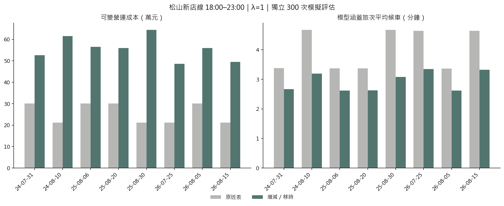
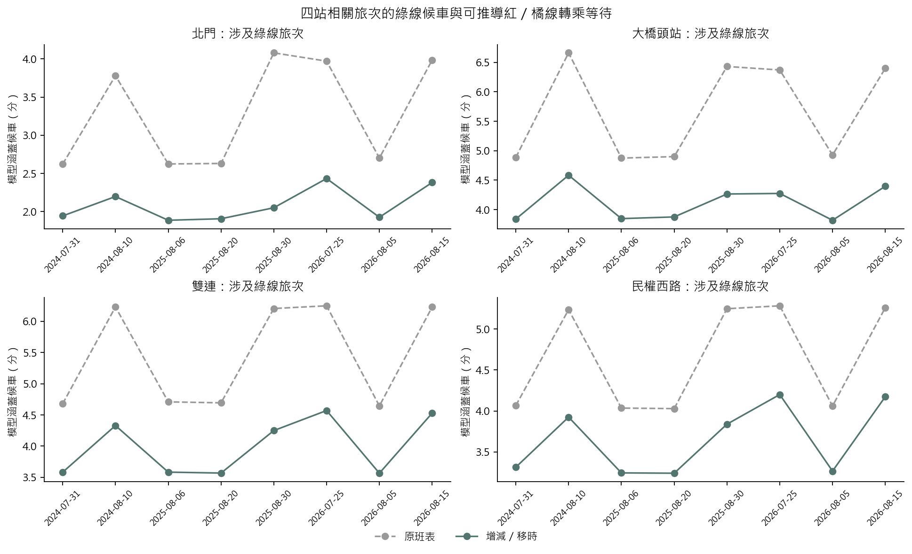
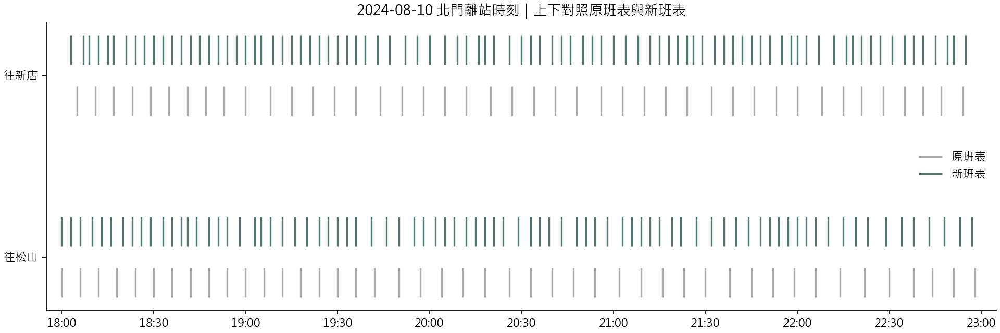

# 18:00–23:00 松山新店線增減班與移時比較

**這是列車載客守恆的回顧模擬與啟發式班表搜尋，不是已證明全域最佳或現場調度命令。**

## 方法

$$\min_{x\in\mathcal P}\;\Delta C_{\rm op}(x)+\lambda\frac{196}{60}\frac1S\sum_s W_s(x).$$

- 原班表包含在候選中；允許增班、減班、前後移時。只選訓練情境中完成疏運的候選。
- 每場 200 次訓練情境，其中前 12 次搜尋並初篩每個 λ 前 10 名（另保留原班表），再用完整 200 次重新評分；獨立 300 次只評估，不反過來選方案。這是新亂數，不是 300 場新的實測活動。
- 移時依最終時刻一對一配對（最多 5 分鐘）；同一移時服務不再被重複算成增班及減班。
- P95 為合併模擬乘客的近似候車分位數，使用分鐘分箱；同組同時到達的背景旅次，其轉乘前等待以加權平均合併，未保留這部分組內變異。不是「情境 P95 超過某門檻的機率」。
- 沿用凍結人流模型，不重新調參。2024-07-17 因沒有較早的同口徑預測誤差，未納入這次八場比較。

$$\Delta C_{\rm op}=128.05\times18.77\times(2N_{\rm add}-N_{\rm remove}).$$

新增服務按完整松山—新店一趟加假設一趟空車回送計費；減班只扣可避免的單程服務費。班數是服務趟次，不是需要的實體車組數。λ=0.5、1、2 表示不同時間價值偏好，不能跨 λ 比較加權總成本來選偏好。

## 獨立模擬評估（λ=1）

| 活動 | 原班數→新班數 | 增／減／移時 | 可變成本差（元） | 平均候車原→新（分） | 總等待變化 |
|---|---:|---:|---:|---|---:|
| 2024-07-31 | 125→172 | +47／−0／82 | +225,929 | 3.38→2.67 | -21.2% |
| 2024-08-10 | 88→172 | +84／−0／59 | +403,788 | 4.67→3.19 | -31.6% |
| 2025-08-06 | 125→180 | +55／−0／85 | +264,385 | 3.37→2.62 | -22.3% |
| 2025-08-20 | 125→179 | +54／−0／87 | +259,578 | 3.38→2.63 | -22.2% |
| 2025-08-30 | 88→178 | +90／−0／59 | +432,630 | 4.67→3.08 | -34.0% |
| 2026-07-25 | 88→145 | +57／−0／71 | +273,999 | 4.64→3.35 | -27.8% |
| 2026-08-05 | 125→179 | +54／−0／86 | +259,578 | 3.36→2.62 | -22.2% |
| 2026-08-15 | 88→147 | +59／−0／66 | +283,613 | 4.64→3.32 | -28.4% |

合計增 500 班、減 0 班、移時 595 班；可變營運成本差 +2,403,498 元，總候車人分鐘變化 -26.2%。負的成本差才是本模型下的可變支出節省；不是實測節省。







## 八場合計與權重敏感度

| λ | 增／減／移時 | 可變營運成本原→新（元） | 平均候車原→新（分） | 總等待變化 |
|---:|---:|---:|---:|---:|
| 0.5 | +143／−0／617 | 2,047,781→2,735,181 | 3.89→3.37 | -13.5% |
| 1 | +500／−0／595 | 2,047,781→4,451,279 | 3.89→2.87 | -26.2% |
| 2 | +1041／−0／513 | 2,047,781→7,051,865 | 3.89→2.55 | -34.6% |

候車改善與營運成本須一起看；若減班未被選中，表示在目前需求、成本與時間估值下，搜尋較偏好保留／增加服務，不代表程式禁止減班。`paired_mc_se` 只衡量固定需求假設下的模擬誤差，不包含路徑、預測或成本參數的不確定性。

## 四站相關旅次的候車拆分（λ=1，八場合併）

| 相關車站 | 綠線平均候車原→新（分） | 可推導紅／橘線段候車原→新（分） |
|---|---:|---:|
| 北門 | 2.66→1.46 | 0.69→0.64 |
| 大橋頭站 | 3.11→1.74 | 2.54→2.35 |
| 雙連 | 2.79→1.60 | 2.53→2.32 |
| 民權西路 | 2.59→1.81 | 1.89→1.72 |

按模擬旅次人數加權。紅／橘線段包含綠線前的候車與可推導後續轉乘；前段班表固定，後續可趕上的班次仍可能改變。這不代表已模擬紅／橘線全線容量或月台排隊。

## 假設與界線

- 只調整北門離站落在 18:00（含）至 23:00（不含）的松山—新店完整服務；其他時段與紅／橘線班表固定。
- 四站採封存年度四站 XGBoost 預測；各場誤差只抽較早活動。其他 OD 採前 56 日內最多六個同星期、非活動日均值。歷史發布時點未全面核實。
- 用官方站間時間推導最短時間路徑；轉乘步行與進站至月台各 5 分鐘均為研究假設。OD 沒有實際轉乘路徑，不能視為觀測。
- 綠線逐站載客守恆，六車容量上限 2,220 人，先下後上，同分鐘旅次比例分配座位。來源 OD 的進站小時以分鐘分布轉為月台到達代理。
- 紅／橘線連接班表由四站官方時刻表與站間時間平移推導，班次不變；可計算錯過下一班的等待，但未重建紅／橘線車上容量。其他路線候車未完整重建。
- 四站影響按出發站優先歸屬；出發站不在四站時再按目的站歸屬，避免重複相加。不經綠線者另列為未調整旅次。
- 17:00–18:00 用一般日 OD 暖機；需求輸入到 23:00，23:00 後固定班次繼續疏運至共同終點 02:00。沒有 P95 10 分鐘／5% 硬門檻，也沒有任意期末 60 分鐘懲罰。
- 平均候車的分母為 17:00–23:00 進站且路徑涉及綠線的模型旅次，包含暖機與一般背景需求；不是北門單站或散場尖峰平均，不能直接與舊版北門剩餘容量情境的平均比較。
- 同向新增或改動班次相隔至少 120 秒是研究假設，不是已確認的號誌安全極限；原有分鐘四捨五入的相鄰班次保留並稽核。
- 保留、減班與移時只計單程服務的可變成本；新增服務另外計一次假設全程空車回送。128.05 元／列車公里仍為待核實代理；既有人員、折舊等固定成本不因減班扣除。
- 17:00 前已在途的乘客、全線實際選路、車庫出入、備車、司機與折返接續尚未完整建模；不是可直接執行的營運命令。

## 重現與輸出

```powershell
uv sync --inexact --group analysis --extra transit
uv run --group analysis --extra transit python -X utf8 src/run_green_dispatch.py --reuse --update-readme
uv run --group analysis python -X utf8 -m app.export_dispatch
```

[逐場成本等待](comparison.csv)／[四站影響](station_impacts.csv)／[班表變更](timetable.csv)／[權重比較](summary.csv)／[稽核](audit.json)

## 參考資料

- [北捷各站時刻表與站間時間（原始來源索引）](https://github.com/shu-ming0808/Statistical-Practice-final/blob/main/docs/metro_operations.md)
- [北捷站間行駛與停靠時間](https://data.taipei/dataset/detail?id=513e97fe-6a98-4a0d-b7dc-11122c8638d4)
- [北捷分時 OD 原始資料](https://data.taipei/dataset/detail?id=63f31c7e-7fc3-418b-bd82-b95158755b4d)
- [勞動部：2026 年最低時薪 196 元（時間價值換算是本研究假設）](https://www.mol.gov.tw/1607/28690/2282/2284/2290/7121/)
- [北捷官方最短距離與沿路線里程加總](https://github.com/shu-ming0808/Statistical-Practice-final/blob/main/result/metro_distances/report.md)
- [Li et al. (2023)：營運成本、候車與班表整合最佳化](https://journals.plos.org/plosone/article?id=10.1371/journal.pone.0285932)
- [Santanam et al. (2021)：特殊活動需求預測與列車模擬](https://arxiv.org/abs/2106.05359)

論文支持需求、候車與營運成本整合的研究方向；本案的分鐘化、搜尋、成本及步行參數是自行實作與假設，不是重現原論文最優解。
