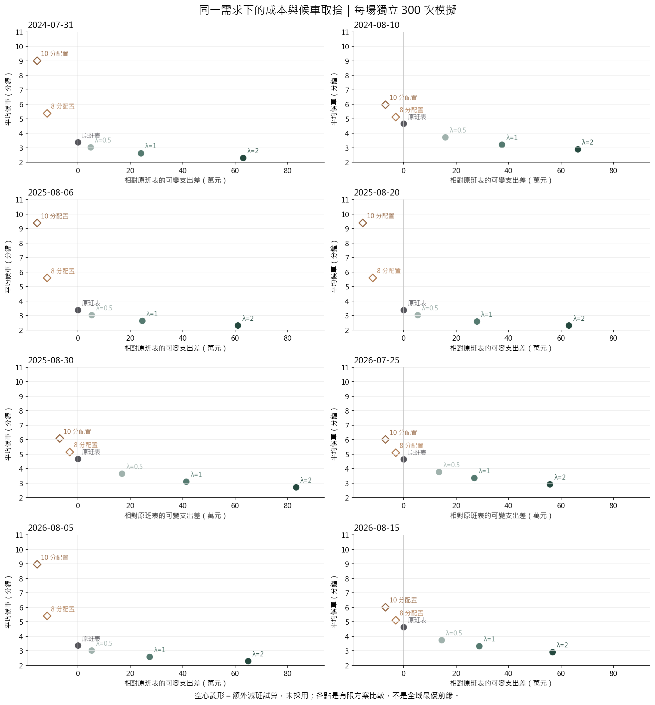
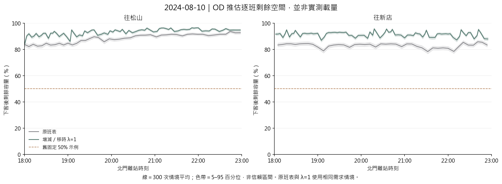

# 為何增班卻沒有減班：成本、候車與逐班載量診斷

**結論：減班方案能完成本次模擬疏運，但在目前時間價值與需求下，額外候車代價高於省下的營運費。另有候選初篩限制，不能證明所有減班組合都較差。**

## 1. 直接檢查減班，而不只看最後入選方案

沿用原八場、18:00–23:00 決策窗、相同較早活動誤差與一般日 OD，以及原 200 訓練／300 評估亂數。新增固定 8／10 分鐘配置作診斷，窗外服務仍保護。方案的班距也檢查與窗外列車的間隔。這些是預先指定的額外試算，沒有按評估結果替換已採用班表。

逐班取消共檢查 852 個原班表服務，先以原 12 個訓練提案情境初篩，各 λ 保留前三名的聯集，再用完整 200 情境選擇，最後獨立 300 情境評估。沒有窮舉同時取消多班及所有重排組合。

| 方案 | 增／減／移時 | 相對原表支出差（元） | 平均候車（分） |
|---|---:|---:|---:|
| 原班表 | +0／−0／0 | +0 | 3.895 |
| λ=0.5 | +169／−0／615 | +812,382 | 3.308 |
| λ=1 | +496／−0／608 | +2,384,271 | 2.868 |
| λ=2 | +1069／−0／520 | +5,138,680 | 2.527 |
| 8 分配置 | +0／−248／492 | -596,068 | 5.353 |
| 10 分配置 | +0／−376／384 | -903,715 | 7.911 |

平均候車以同批模型旅次人數加權；涵蓋全綠線背景與可推導轉乘，不是北門散場單站平均。增／減／移時按原專案逐班配對，不能將時段熱圖的正負格直接加總成費用。



## 2. 三個原因

1. **時間成本門檻。** 取消一班節省 2,403.50 元；新增一班含假設全程空車回送為 4,807.00 元。λ=1 時，取消造成的額外等待必須低於 735.76 人分鐘才划算。例如 500 人各多等 2 分鐘就是 1,000 人分鐘，不是只多等 2 分鐘。
2. **背景需求占比。** 八場合計模型旅次中，「其他旅次」占 85.9%。目標會計算一般乘客等待，因此加密服務的效益不只出現在散場。
3. **原搜尋先按偏好初篩。** 原完整訓練候選都沒有取消服務；稀疏方案可能在 12 情境初篩階段被排除。這次強制留下 8／10 分鐘減班試算，才能看到省費用與增加等待的另一側。

$$\Delta J=-c_{\mathrm{cancel}}+\lambda v\,\Delta W,\qquad v=196/60. $$

$$\Delta W>0\ \Longrightarrow\ \lambda_{\mathrm{break-even}}=\frac{c_{\mathrm{cancel}}}{v\Delta W}. $$

各場經完整訓練選出的單班取消方案，其損益兩平 λ 約 0.123–0.258，低於現行最小值 0.5。這是依既定成本的局部診斷，不是建議事後把 λ 調低到一定能減班；λ 應反映明確的服務與支出偏好。
所有被評估減班方案的未完成旅次、最大載量與班距見 CSV；模擬中能疏運，不代表已有實際備車、司機與折返可行性。

## 3. 固定 50% 可以怎麼改

**舊候車回放仍用固定剩餘空間情境，新版全線調度已用 OD 動態載客。** 剩餘空間 50% 與兩方向各 50% 是不同參數；新版用歷史 OD 起迄與假設路徑分配方向，再逐站先下後上。

$$L_{k,s}^{\mathrm{pre}}=L_{k,s}^{\mathrm{arr}}-A_{k,s},\quad R_{k,s}=C-L_{k,s}^{\mathrm{pre}},\quad B_{k,s}=\min\{Q_{k,s},R_{k,s}\},\quad L_{k,s}^{\mathrm{dep}}=L_{k,s}^{\mathrm{pre}}+B_{k,s}. $$

`Larr` 為抵站車上人數、A 為下車人數、R 為可用容量、Q 為本班上車前隊伍、B 為上車人數；C=2,220。到下一站仍保留車上目的站結構，取消前車後的人潮會累積到後車，不能把每班空位重設為一半。

本次只為既有模擬增加讀值，重播原班表與 λ=1 各 300 次情境，逐場核對總候車與已發布結果一致，沒有重新選方案。線是逐班平均，帶是情境分位數；不能稱為實測或實際載量的信賴區間。



**目前資料能做到：**小時 OD＋假設路徑＋官方時刻與站間時間，推估每列車沿線上下車。**目前不能做到：**唯一還原每個人搭哪班、準確分鐘到達或實際列車載量。若補刷卡進出時間、列車運行紀錄與載重感測，才可校準乘車機率與載量。現有方向比例與選路也仍須做敏感度分析。

文獻支持網路載客與乘客—列車配對的方向，本專案沒有宣稱重現文獻的校準精度。北捷 TIMES 證明載重感測與 AFC 校準具有實務依據，但該簡報未提供本案歷史綠線逐列車原始載量。

## 4. 下一步與資料界線

- 先核實每列車公里成本、回送里程與服務偏好，再決定要接受多少等待交換多少支出，不能按期待的減班數反推權重。
- 保留減班候選作研究比較；若要改採用機制，應將省費用候選正式納入訓練選擇，並另留未反覆檢視的活動驗證。
- 補全車組、折返、司機及回送軌道占用；本版不提供可直接執行的營運命令。
- 全線普通日需求、最短時間路徑、分鐘分布及步行仍是模型假設；歷史資料發布時間未全面核實，保持回顧情境定位。

## 重現與輸出

```powershell
python -X utf8 src/diagnose_green_dispatch.py --reuse
python -X utf8 src/green_load_trace.py
python -X utf8 scripts/report_dispatch_diagnostics.py
python -X utf8 -m app.export_dispatch_diagnostics
```

[逐場取捨點](tradeoff_points.csv)／[合計](tradeoff_summary.csv)／[逐班取消提案](removal_proposals.csv)／[訓練選出的取消診斷](selected_removals.csv)／[成本來源拆分](cost_drivers.csv)／[逐站影響](station_impacts.csv)／[逐班載量](../green_load_profile/beimen_load_profile.csv)／[載量守恆與重播核對](../green_load_profile/reconciliation.csv)

## 參考資料

- [Mo et al. (2020)：容量限制下的都市軌道網路載客模型](https://journals.sagepub.com/doi/abs/10.1177/0361198120914309)
- [Zhu et al. (2017)：以實際班表與 AFC 推估乘客搭車選擇](https://onlinelibrary.wiley.com/doi/10.1155/2017/5824051)
- [Su et al. (2022)：乘客與列車配對機率及網路人流分配](https://www.mdpi.com/1099-4300/24/8/1026)
- [臺北捷運 TIMES：載重感測與 AFC 校準（PDF 第 8、10–13、19 頁）](https://www-ws.gov.taipei/001/Upload/799/relfile/10173/8554762/63923974-318f-4dd6-816a-b06607271d9b.pdf)
