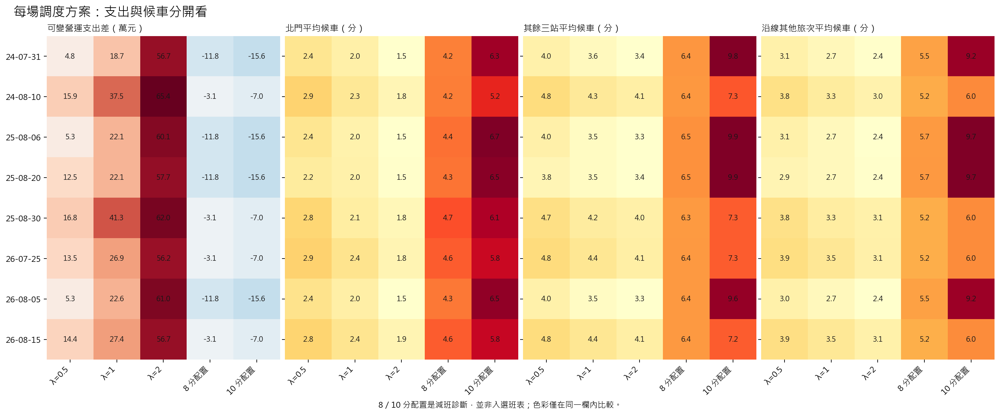
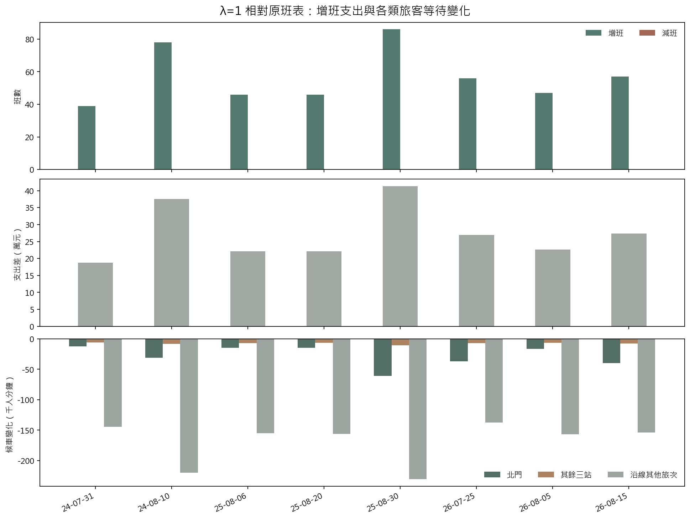

# 調度目標分解：增班是誰的等待改善？

沿用已完成的 8 場獨立評估結果，不重新選班表；每場將候車人分鐘拆為北門、其餘三站及沿線其他旅次。後者是模型群組，不能直接當成實測乘客。

λ=1 的 8 場方案合計增 455 班、減 0 班；相對原班表的可變支出 +2,187,184 元。
總候車減少 1,639,497 人分鐘，其中北門 226,352（13.8%）、其餘三站 58,860（3.6%）、沿線其他旅次 1,354,285（82.6%）。

8／10 分配置是減班診斷，沒有被原選擇器正式採用。圖中只顯示有限方案，不能聲稱已求出全域 Pareto 前緣。

[逐場數據](per_event_metrics.csv)；來源：`result/green_dispatch/comparison.csv`、`station_impacts.csv` 與 `result/green_dispatch_diagnostics/`。

重跑：`python -X utf8 scripts/report_dispatch_tradeoff_split.py`。
