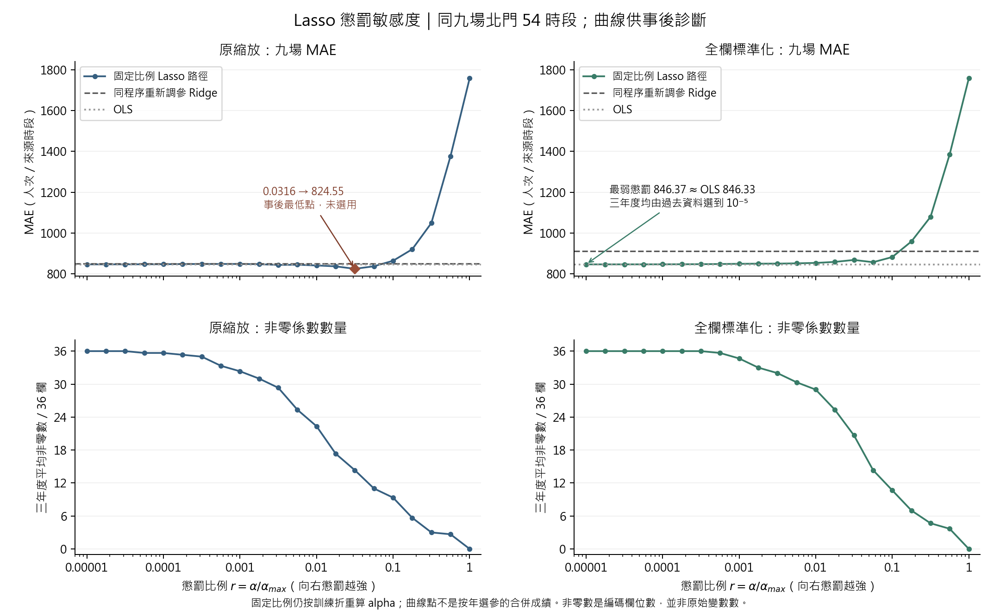

# 線性模型與 Lasso 懲罰敏感度補充

本頁匯入隊友 `Lasso_Ridge_實驗分享_2026-10-28` 的結果，於 2026-10-29 核對數值與整理圖表。**本次未重現訓練**：分享包未附 `src/run_lasso_ridge_experiment.py`、`src/run_lasso_ridge_robustness.py`。本次完成的是逐時預測重算、選參表與路徑彙總核對。

核心結論：原縮放下，低懲罰 Lasso 對同程序 Ridge 的 MAE 改善約 **0.315%（2.68 人次）**，散場窗口低估略增；全欄標準化的 Lasso 幾乎等同 OLS。它們均未改變目前保留的 **XGBoost 散場加權**，也不改寫凍結 Ridge 公式。

## 1. 比較範圍與兩種縮放

隊友以相同 21 場四站輸入、相同特徵設計，逐年評估 2024–2026 同九場北門、54 個 18–23 時來源時段；2024／2025／2026 分別用過去 12／15／18 場訓練。匯入時已將隊友評估列的鍵、實際值與共用輸入欄位逐一對齊凍結輸入，並核對其 SHA-256；本目錄不攜帶私有訓練輸入或原始 OD。

- **原縮放：**連續欄標準化，類別編碼維持 0/1。
- **全欄標準化：**再將編碼後的所有欄位標準化。依隊友方法說明，補值、編碼與縮放均只由各訓練折擬合；缺少原始訓練程式，這項實作本次無法直接驗證。
- **同程序重新選參：**Ridge 候選為 λ=0 及 10⁻⁶–10²；Lasso 為 r=alpha/alpha_max 的 21 個比例（10⁻⁵–1），alpha_max 依當次訓練折計算。兩者都用過去驗證活動的北門 MAE 選擇，不能直接比較兩種懲罰參數的數值大小。
- **原專案凍結模型：**沿用既有選參與訓練規則，其成績是同九場的背景對照；不是與隊友重新調參 Ridge 相同的估計程序。

九場曾反覆參與開發，隊友也曾看過九場結果後擴大候選範圍。因此年度先後順序正確仍不足以稱為完全未見資料的驗證；本頁屬探索性回顧比較。

## 2. 四個指標的完整比較

下表數值皆越小越好，單位為人次／來源時段。MAE、RMSE 在九場共 54 列計算；每場都恰有六列。`peak_abs` 是每場**實際**最高人次時段的預測絕對誤差，再對九場取平均。`window_under` 先對每場預定結束後兩小時與來源時段的重疊比例正規化，對正向低估 max(實際−預測, 0) 加權，再平均九場；它不是散場總漏估人數。九場都有可用的預定散場窗口。

| 設定／來源 | 模型 | MAE | RMSE | 尖峰絕對誤差 | 散場窗口低估 |
|---|---|---:|---:|---:|---:|
| 原專案凍結 | Ridge | 845.44 | 1,547.49 | 2,681.26 | 1,413.98 |
| 原專案凍結 | GAM | 830.71 | 1,315.75 | 2,305.11 | 1,132.68 |
| 原專案凍結 | XGBoost 未加權 | 473.91 | 766.90 | 749.02 | 405.96 |
| 原專案凍結 | XGBoost 散場加權（保留） | 440.28 | 690.91 | 747.14 | 483.61 |
| 原縮放 | 重新調參 Ridge | 851.20 | 1,330.65 | 2,315.35 | 1,188.17 |
| 原縮放 | 低懲罰 Lasso | 848.52 | 1,327.64 | 2,298.63 | 1,202.63 |
| 原縮放 | OLS | 846.33 | 1,313.54 | 2,272.91 | 1,203.39 |
| 全欄標準化 | 重新調參 Ridge | 911.94 | 1,580.99 | 2,469.48 | 1,554.51 |
| 全欄標準化 | 低懲罰 Lasso | 846.37 | 1,313.59 | 2,272.99 | 1,203.43 |
| 全欄標準化 | OLS | 846.33 | 1,313.54 | 2,272.91 | 1,203.39 |

原縮放的 Lasso 比重新調參 Ridge 小幅降低 MAE、RMSE、尖峰誤差，但散場窗口低估由 1,188.17 增至 1,202.63；不能說所有指標都改善。全欄標準化的 Lasso MAE 846.37 與 OLS 846.33 僅差約 0.03，且保留 36/36 欄，優勢不能解釋為有效刪除變數。OLS 在兩種縮放下預測一致至浮點誤差。

既有 XGBoost 散場加權在四項指標皆低於這批線性結果，維持原選擇；既有 XGBoost 未加權的窗口低估又低於加權版本，表示即使主模型也存在指標取捨。

## 3. Lasso 懲罰參數敏感度

比例 r 越小，懲罰越弱；比例固定時，各年度實際 alpha 仍不同。下表與圖是**將同一比例套用各年度後的九場路徑**，不等於按年度選到不同比例的合併成績。非零數為三個年度模型的平均，分母是 36 個編碼欄，不能當成原始變數數量。

| 固定 r=alpha/alpha_max | 原縮放 MAE | 原縮放平均非零數 | 全欄標準化 MAE | 全欄標準化平均非零數 |
|---:|---:|---:|---:|---:|
| 1 | 1,758.03 | 0.00 | 1,758.03 | 0.00 |
| 0.1 | 864.01 | 9.33 | 882.16 | 10.67 |
| 0.031623 | 824.55 | 14.33 | 868.02 | 20.67 |
| 0.01 | 840.99 | 22.33 | 853.43 | 29.00 |
| 0.001 | 848.36 | 32.33 | 849.05 | 34.67 |
| 1e-05 | 846.42 | 36.00 | 846.37 | 36.00 |

從 r=0.1 降至 0.01，原縮放 MAE 864.01 → 840.99；再降至 0.001，反而增至 848.36，因此不是懲罰越弱越好。原縮放 r≈0.0316 的 **824.55 是檢視九場後才知道的 MAE 最低點，未被過去資料選到，未採為模型**。該點 RMSE 1,479.58、尖峰絕對誤差 2,457.94，均高於同程序 Ridge（1,330.65、2,315.35）。

## 4. 過去資料實際選到的年度設定

下表 Ridge 的「參數」是 λ，實際 alpha=nλ；Lasso 的「參數」是 r，實際 alpha=r×alpha_max。兩者的目標函數正規化不同；不能把同一欄的數值大小當作兩模型懲罰強度的比較。

| 評估年度 | 縮放 | 模型 | 參數 λ 或 r | 實際 alpha | 非零欄數 |
|---|---|---|---:|---:|---:|
| 2024 | 原縮放 | 重新調參 Ridge | 0.00031622777 | 0.091073597 | 36/36 |
| 2024 | 原縮放 | 低懲罰 Lasso | 0.00056234133 | 0.44867088 | 34/36 |
| 2024 | 全欄標準化 | 重新調參 Ridge | 1 | 288 | 36/36 |
| 2024 | 全欄標準化 | 低懲罰 Lasso | 1e-05 | 0.0079786218 | 36/36 |
| 2025 | 原縮放 | 重新調參 Ridge | 0.001 | 0.36 | 36/36 |
| 2025 | 原縮放 | 低懲罰 Lasso | 0.001 | 0.79417481 | 34/36 |
| 2025 | 全欄標準化 | 重新調參 Ridge | 1 | 360 | 36/36 |
| 2025 | 全欄標準化 | 低懲罰 Lasso | 1e-05 | 0.0079417481 | 36/36 |
| 2026 | 原縮放 | 重新調參 Ridge | 0.0017782794 | 0.76821671 | 36/36 |
| 2026 | 原縮放 | 低懲罰 Lasso | 0.001 | 0.81391487 | 32/36 |
| 2026 | 全欄標準化 | 重新調參 Ridge | 0.0017782794 | 0.76821671 | 36/36 |
| 2026 | 全欄標準化 | 低懲罰 Lasso | 1e-05 | 0.0081391487 | 36/36 |

原縮放 Lasso 是 2024 選 0.00056234，2025／2026 選 0.001，合併 MAE 才是 **848.52**；全欄標準化三年都選 10⁻⁵，合併 MAE **846.37**。前者不是任一條固定比例曲線的單點。

## 5. 核對範圍、來源與重建

本次由 54 列輸出重算兩種縮放 × 三模型 × 全期間／三年度，共 **24 列的四項指標**；核對 **12 組年度選參**均是已提供過去活動紀錄的 MAE 最小值，**660 列調參紀錄**的驗證年皆早於評估年，且 **126 列年度路徑可彙總回 42 個路徑點**。這些核對證明已提供表格的內部一致性，不證明訓練程式已重跑或完整流程無洩漏。固定路徑未提供逐時預測，所以只驗證其年度到總體的彙總。

來源檔案及保留副本的 SHA-256 見 [provenance.json](provenance.json)，本次檢查結果見 [validation.json](validation.json)。原始分享包逐時檔僅投影保留鍵、真值、六組預測及衍生評分權重於 [evaluation_predictions.csv](evaluation_predictions.csv)，不攜帶完整特徵面板。其餘五份來源 CSV 保留原始位元組。

- [十組模型比較 CSV](comparison.csv)／[來源指標](source/factorial_metrics.csv)／[凍結模型指標快照](source/frozen_forecast_metrics.csv)
- [年度選參](source/factorial_choices.csv)／[過去年度調參紀錄](source/factorial_tuning.csv)
- [完整 42 點敏感度](source/factorial_penalty_summary.csv)／[年度路徑](source/factorial_penalty_path.csv)

從專案根目錄執行 `python scripts/report_linear_sensitivity.py` 可用已保留 CSV 重做數值核對、比較表與圖；需要 numpy、pandas、matplotlib 及可顯示繁體中文的字型。**不需要原下載資料夾、資料庫、私有輸入或模型訓練程式**。此命令不修改 README 或凍結模型檔。
