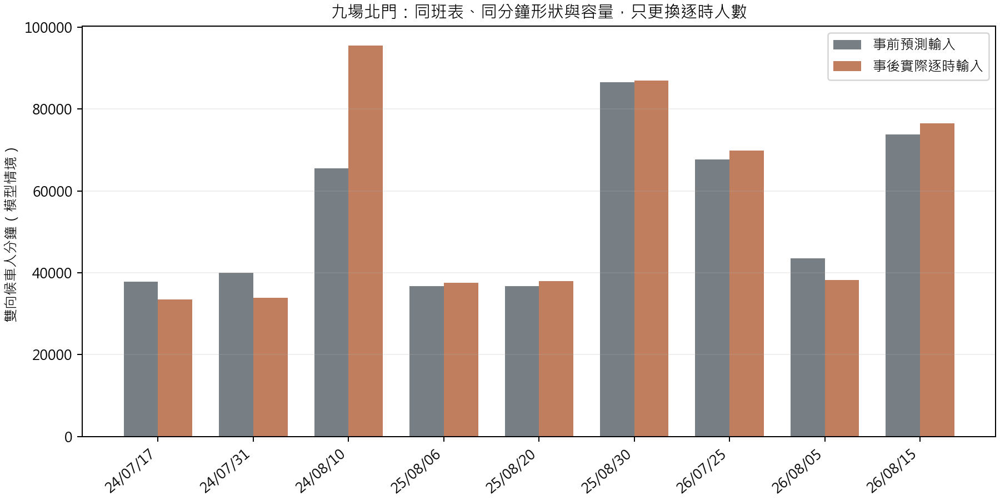

# 預測誤差與北門候車情境的回顧檢查

只把封存預測換成事後實際逐時 OD 人數；日期、兩方向班表、分鐘分布形狀、方向 50:50、每班剩餘容量及 5 分鐘站內延遲都固定。實際逐時人數只作事後檢查，不是活動前一天的輸入。

中心展示：預測最高小時內採寬峰 σ=20 分；每班剩餘容量 1,110 人。完整 3 種形狀 × 3 種容量 × 2 方向見 CSV。

| 日期 | 預測人次 | 實際人次 | 預測情境候車人分鐘 | 事後情境候車人分鐘 | 差額 |
|---|---:|---:|---:|---:|---:|
| 2024-07-17 | 13,936 | 12,395 | 37,875 | 33,499 | -4,376 |
| 2024-07-31 | 14,605 | 12,574 | 39,998 | 33,877 | -6,121 |
| 2024-08-10 | 18,115 | 26,423 | 65,516 | 95,520 | +30,004 |
| 2025-08-06 | 13,492 | 13,913 | 36,674 | 37,599 | +925 |
| 2025-08-20 | 13,528 | 13,992 | 36,778 | 37,947 | +1,169 |
| 2025-08-30 | 23,930 | 23,848 | 86,524 | 86,936 | +412 |
| 2026-07-25 | 18,747 | 19,330 | 67,638 | 69,829 | +2,191 |
| 2026-08-05 | 15,697 | 14,044 | 43,514 | 38,178 | -5,336 |
| 2026-08-15 | 20,472 | 21,230 | 73,802 | 76,527 | +2,725 |

正差額表示在相同假設下，實際人數造成的模擬等待多於事前預測。這不是實測候車時間，也不是全線班表調度的回測；未觀測分鐘到達、方向比例與逐班載量。使用 2026/8/30 一般班表反事實重播 2024–2026 活動，不能代表活動當日實際班表。

九場已反覆檢視，這是模型診斷而非新活動的獨立驗證。若要確認調度方案在預測誤差下的可靠度，下一步須用觀測逐班載量與活動實際班表重播全線。

[逐組結果](paired_scenarios.csv) · [差額](comparison.csv) · [逐場摘要](event_summary.csv)
