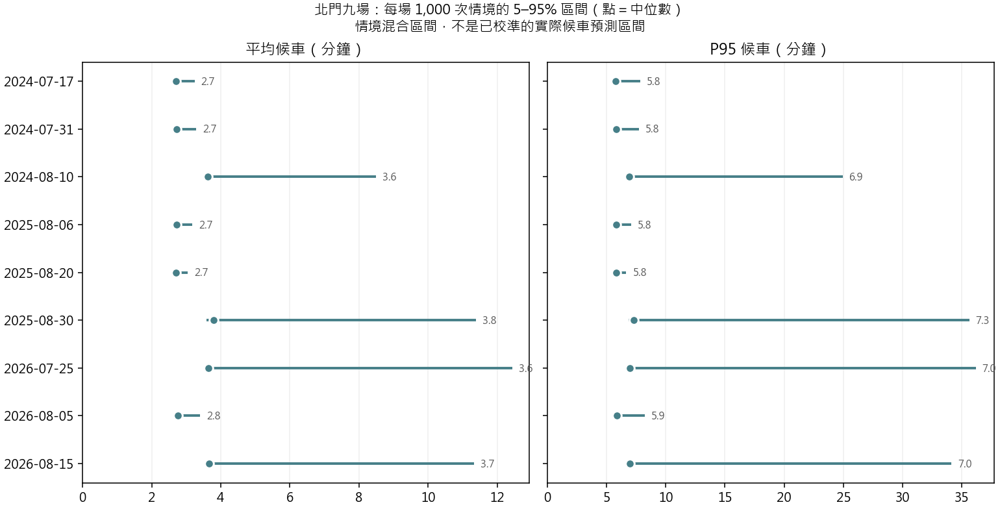
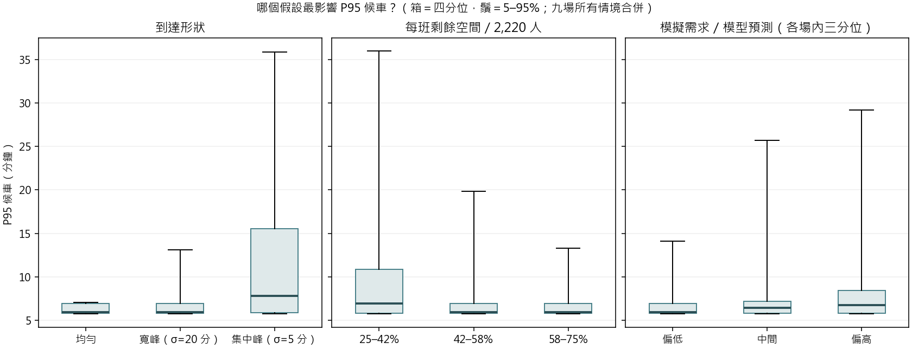

# 北門候車不確定性模擬（第一版）

**固定 V14 四站 XGBoost 的北門預測，沒有重新訓練。區間是「情境混合」：結合其他場次的預測誤差、假設的分鐘形狀、隨機到達與假設剩餘容量。不是已校準的實際候車預測區間。**

## 1. 每次模擬抽什麼

每場 1,000 次，共 9,000 次；亂數種子 20261025，重跑結果相同。

| 不確定性 | 抽法 | 依據 |
|---|---|---|
| 小時人數 | 預測 × 另一場的「實際／預測」六時段比例（整組一起抽） | 九場留出預測；**絕不使用本場自己的實際值** |
| 分鐘形狀 | 均勻／寬峰／集中峰各 1/3；峰中心第 15／30／45 分 | V1 假設，未經分鐘資料校準 |
| 隨機到達 | 每分鐘 Poisson，再以二項分布拆方向 | 到達彼此獨立的假設 |
| 方向比例 | 往松山 40%–60% 均勻 | V1 敏感度範圍 |
| 剩餘容量 | 2,220 人的 25%–75% 均勻 | V1 敏感度範圍，非量測值 |

等待時間以累積到達與累積上車曲線的水平距離計算（先到先上），兩方向合併後取 P95。
檢核：比例＝1、無隨機到達、V1 設定時，九場 × 三形狀 × 三容量的平均候車與 V1 最大差 7.1e-13 分。

## 2. 結果

| 指標 | 5% | 中位數 | 95% |
|---|---:|---:|---:|
| 平均候車（分） | 2.68 | 2.90 | 8.12 |
| P95 候車（分） | 5.73 | 6.15 | 22.97 |

- 有乘客跨班滯留的情境：32.6%；P95 超過 10 分鐘：16.5%；末班後仍未清空：0.00%。
- 沒有人被留下時，P95 約等於 0.95 個班距，所以有底線：平日場約 5.8 分、週六場約 7 分（週六晚間班距較長）。超過底線的長尾都來自跨班滯留。

| 活動 | 平均候車 中位數（5–95%） | P95 候車 中位數（5–95%） | 跨班滯留機率 |
|---|---:|---:|---:|
| 2024-07-17 | 2.71（2.65–3.24） | 5.78（5.69–7.84） | 19.0% |
| 2024-07-31 | 2.73（2.69–3.29） | 5.82（5.73–7.73） | 16.8% |
| 2024-08-10 | 3.63（3.58–8.49） | 6.91（6.87–24.94） | 41.3% |
| 2025-08-06 | 2.71（2.66–3.18） | 5.81（5.71–7.11） | 17.5% |
| 2025-08-20 | 2.71（2.66–3.04） | 5.81（5.71–6.68） | 16.3% |
| 2025-08-30 | 3.79（3.58–11.39） | 7.32（6.88–35.63） | 58.1% |
| 2026-07-25 | 3.64（3.57–12.44） | 6.95（6.87–36.17） | 50.9% |
| 2026-08-05 | 2.76（2.72–3.40） | 5.86（5.77–8.22） | 18.1% |
| 2026-08-15 | 3.66（3.57–11.33） | 6.99（6.88–34.13） | 55.0% |

## 3. 哪個假設影響最大

| 因子 | 水準 | P95 中位數 | P95 95% | 跨班滯留機率 |
|---|---|---:|---:|---:|
| 到達形狀 | 寬峰（σ=20 分） | 5.90 | 13.19 | 17.5% |
| 到達形狀 | 集中峰（σ=5 分） | 7.82 | 35.93 | 74.8% |
| 到達形狀 | 均勻 | 5.91 | 7.05 | 7.7% |
| 剩餘容量 | 25–42% | 6.89 | 36.09 | 51.4% |
| 剩餘容量 | 42–58% | 5.95 | 19.83 | 29.2% |
| 剩餘容量 | 58–75% | 5.92 | 13.28 | 16.5% |
| 需求／預測比 | 需求偏低三分位 | 5.95 | 14.15 | 23.4% |
| 需求／預測比 | 中三分位 | 6.41 | 25.72 | 34.4% |
| 需求／預測比 | 需求偏高三分位 | 6.71 | 29.25 | 39.9% |

分組只供閱讀敏感度；因子同時抽樣，不是因果分解。需求比例在各場內切三分位，避免平日／週六班距差異混入。

## 4. 界線

- 預測誤差只來自這九場，而且九場在開發時反覆使用，誤差可能被低估；區間很可能偏窄。
- 比例依「同一時段」借用，另一場的尖峰時段可能不同。
- 分鐘形狀、方向比例、剩餘容量與 5 分鐘步行延遲都仍是假設；上車瞬間完成，不含車門吞吐與月台管制。
- 使用 2026/8/30 起的一般班表，不是當年活動加班表；不是歷史候車重建。

逐次結果：[draws.csv](draws.csv)；逐場：[event_intervals.csv](event_intervals.csv)；因子：[factor_summary.csv](factor_summary.csv)。
